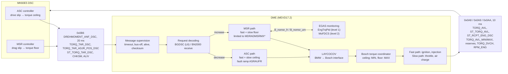
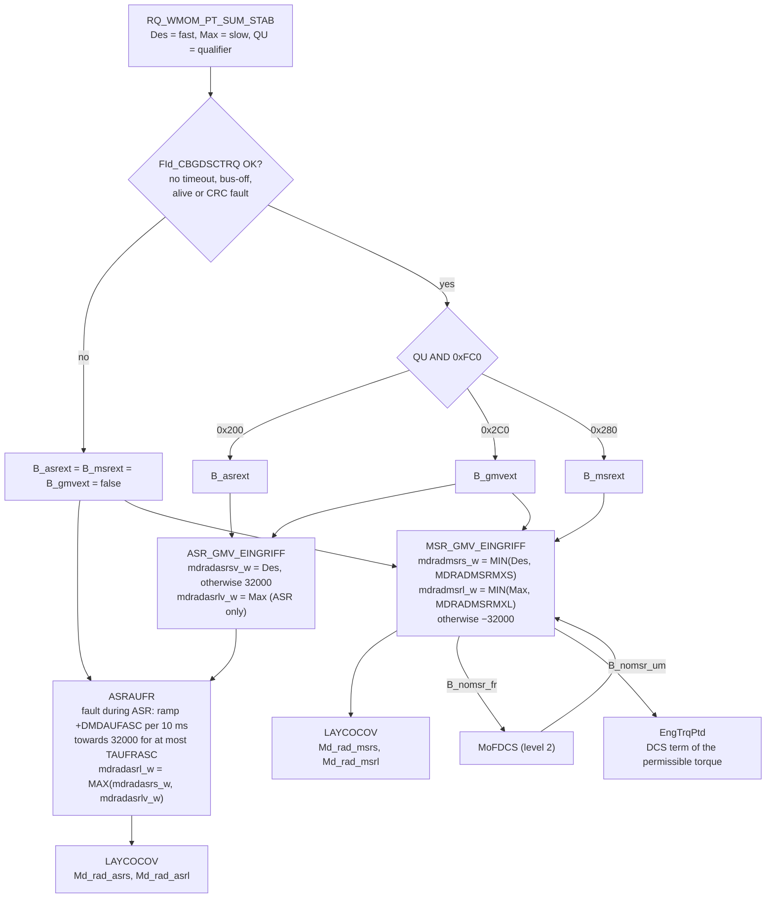

# MK60E5 DSC – CAN interface (PT-CAN + F-CAN)

Reverse-engineered CAN interface of the Continental Teves **MK60E5** DSC (BMW E8x/E9x).
The primary firmware is **7846816A** (SG type `DSCM90`, E9x M3). That is the unit used in this project; its label data and that of the DSC sensor and SZL are listed in the [MK60E5 README](../README.md).
The 6-cylinder firmware **6862873A** (`DSC90`) is kept as the comparison reference.

**Source ranking:**

* **Reference:** BMW's own data, i.e. the SPdaten (DSC firmware, SGBD) and the MEVD17.2 function description.
* **Verification:** a vehicle log, used to check those sources.
* **Secondary:** the E65 documentation, NewTIS, and the community DBC `bmw_e9x_e8x_tomazc.dbc` (compiled by hand from internet sources). They only fill gaps.

## Components

The components used in this project are described in the [MK60E5 README](../README.md):

* the DSC hydraulic unit + controller (M3, firmware 7846816A);
* the yaw / acceleration sensor, which connects to F-CAN (0x0CD/0x0D1/0x0D4);
* the steering column switch cluster SZL, which connects to F-CAN (0x0C9 steering angle, 0x194/0x1D6/0x2A6).

Their connectors and wiring are in [MK60E5-Components](../MK60E5-Components).

## Sources and method

| Source | Role | What it gave |
|---|---|---|
| `E89/E89/data/DSCM90/7846816A.0pa` (MK60E5 M3 flash, plain Intel HEX, SPdaten) | **Reference (primary)** | Complete COM-stack tables of the M3 DSC: every RX/TX frame, DLC, direction, TX cycle, signal start bit/length, cross-bus ID references |
| `E89/E89/data/DSC90/*.0pa` (MK60E5 6-cyl), `DSC81` (MK60E), `DSCM80` (M3) | **Reference (comparison)** | Same table layout → shared PT-CAN matrix; 6862873A adds F-CAN fields the M3 table does not map |
| `E89/E89/ecu/DSC_87.prg` (EDIABAS SGBD "Conti_Teves MK60, BMW_FAST, E8x,E9x", rev. 21.000, SPdaten) | **Reference** | DTC texts that name each monitored frame + matrix of the checks it runs (checksum / alive / timeout); 121 diagnostic jobs whose disassembled code gives the request telegrams and the bit layout of the F-CAN frames 0x194/0x1D6/0x2A6/0x0C9/0x118/0x140 (with value tables and the steering-angle scaling). `DSC_89.prg` is the Bosch DXC8 PLUS of E89/E84, not the MK60E5 |
| `BMW-StandardTools` (EDIABAS + INPA) | Reference (supplementary) | English `DSC_87.prg` (same revision, English DTC texts); INPA source `dsc_87.ips` (which jobs/results BMW's workshop screens show). The other DSC SGBDs and the compiled INPA scripts add nothing for the MK60E5 |
| `E89/E89/daten` (NCS Expert coding data, SPdaten): `MK60_M3.Cxx`, `MK60_87.Cxx`, `SWT*03.dat`, `E89CVT.000`, `E89SGET.000`, `E89AT.000` | **Reference** | DSC coding parameters (address, mask, values) and the vehicle-option rules that set them, e.g. option 544 → `C0F_ECBA_DCC` = 2. See [Coding data](#coding-data-ncs-and-sgbd-tables) |
| `MEVD17.2-Function-Description` (`15-CO/15.2.1.7-CANUE.md`, `15.2.1.4-BGDSC.md`, `15.3.*_co.md`) | **Reference** | BN2000 PT-CAN send/receive table (names, senders, cycles, DLC); ASC/MSR torque intervention; BMW signal definitions of the body frames shared with the BN2000 PT-CAN (0x135, 0x2E4, 0x2F8, 0x2FC, 0x330, 0x380, 0x381, 0x388, 0x395, 0x3B3, 0x3BE) |
| `Shared/CAN-Logs/E92-320i` | Verification | Checksum algorithms (100 %), layout fixes, cycle times, senders, plausibility of every decoded value |
| `Shared/CAN-Logs/E65` (two Vector ASC logs, E65 7 series, Bosch DSC57) | Verification (independent car) | Checksums, alive counters, DLC and cycle of shared PT-CAN frames hold BMW-wide; 0x194 checksum found. See [Cross-check with E65 logs](#cross-check-with-e65-pt-can-logs) |
| `Shared/CAN-Logs/superwofy-E9X-M-CAN-Traces` (K-CAN traces of a 2011 E92 M3 DCT, from [superwofy/E9X-M-CAN-Integration-Module](https://github.com/superwofy/E9X-M-CAN-Integration-Module), MIT) | Verification (same DSC type as the primary firmware) | The JBE copies DSC and DME frames to K-CAN. Checksums, alive counters and bit coverage on an M3; first check of signals that change while moving (wheel speeds, direction, steering angle). See [Cross-check with the E92 M3 K-CAN trace](#cross-check-with-the-e92-m3-k-can-trace) |
| superwofy frame notes (`E-series BN2000/*.txt`, same repository, MIT) | Secondary | Values of the DSC button 0x316, RPA button 0x319, FTM state 0x31D, handbrake 0x34F and traction-mode request 0x398; layout of the M-Drive button frame 0x1D9; signal layouts of about 35 K-CAN frames and of the network-management and Check Control service frames (see [BMW_E9x_K-CAN.md](./BMW_E9x_K-CAN.md)) |
| `Shared/cmg5461-mk60e5-firmware` ([cmg5461/mk60e5-firmware](https://github.com/cmg5461/mk60e5-firmware), MIT) | Secondary (independent disassembly of the same firmware 7846816A) | Handler-level meaning of the RX/TX signals (`analysis/CAN_RX_TABLE_7846816A.md`, `CAN_TX_TABLE_7846816A.md`), the DSC driver-mode logic (0x398, 0x399, hardwired DSC button), coding bytes, EEPROM map and the minimum PT-CAN frame set for standalone use (`docs/PTCAN_FRAMES_EXPECTED.md`). Not yet cross-checked against this document frame by frame |
| `E89/E89/ecu/JBBF70.prg` (table `ZUORDNUNG_CAN_ID_SG`, 467 IDs) and `ACC2.prg` (table `CANID`), SPdaten | Reference (names) | BMW frame names and senders of the BN2000 CAN IDs; identifies 0x1D9 as "Bedienung Taster M-Drive" from the SZL. The K-CAN modules' SGBDs contain no CAN bit layouts (they read decoded values by local identifier) |
| [HeinrichG-V12/E65_ReverseEngineering](https://github.com/HeinrichG-V12/E65_ReverseEngineering) (E65 PT-CAN, from a Bosch MED 9.2.1 document) | Secondary | BMW signal names, scaling and value tables for PT-CAN frames that the reference sources don't detail; sender list |
| `NewTIS-Extracts/*.pdf` (BMW TIS: system overview, functional description, DSC sensor, SZL, wheel sensors, X18303 pinout) | Secondary | Bus topology (JBE gateway), purpose of several RX/TX frames, option 544 (DSC replaces LDM), redundant DSC sensor, connector pinout |
| `bmw_e9x_e8x_tomazc.dbc` (community DBC) | Secondary (lowest) | Fills bits no other source defines; its names are kept only where no official name exists |

Firmware table format (both buses):

```
Message record, 23 bytes, big-endian:
  [0:2] CAN-ID   [2] lo-nibble DLC   [3] bit3 = TX   [4] TX cycle x10 ms (FF = event)
  [8] #signal records   [9:11] first signal index   [11] handle   [18:20] gateway destination ID (bytes 16–19 as u32; byte 20 low nibble = DLC of the copy), see [Bus topology](#bus-topology)
Signal record, 5 bytes (table starts 5 bytes before the end of the message table):
  [0] flags  [2] internal variable  [3] bits0-4 length, bit5 signed  [4] lo-nibble byte, hi-nibble bit
  -> Intel (little-endian) layout, DBC start bit = byte*8 + bit
  "ff 00 VV LL PP" = signal with special handling (same VV/LL/PP layout) - NOT necessarily a checksum
                     (0x0AC byte 0 = checksum, but 0x310 byte 0 = outside temperature, see log validation)
  "xx 00 VV 00 ff" = message status variable (timeout/alive/checksum result); M3: "ff 00 VV 00 f0"
  1-bit signal @0 on frames that are only supervised (0x330, 0x380, NM, ...) = "frame received" dummy
  Checksums are computed in code, not in this table; they were identified from the log (bmw_checksum.py).
  The "signed" flag is not reliable: 0x0C4 is flagged unsigned, but the log proves it signed.
Records chain: first(i) = first(i-1) + n(i-1). The extractor walks the table using only this rule.
M3 F-CAN table (newer format): [5] = 0x0A/0xFF, [7] = 0x08/0x20, all signal flags 0xFF. The byte-7
  fields (56|8) that 6862873A maps on its F-CAN RX frames are length-0 placeholders in the M3 table.
```

Table locations:

| Firmware | PT-CAN table | F-CAN table |
|---|---|---|
| `7846816A` (M3, primary) | `0xDFF67–0xE03A0` (47 records) | `0xFD9DF–0xFDCBF` (32 records) |
| `6862873A` (6-cyl, comparison) | `0xE256B–0xE29A4` (47 records) | `0xE82EA–0xE8488` (18 records) |

6862873A also contains an SAE-J1850 CRC-8 lookup table (poly 0x1D) at `0xE7ECE`.

**Hex-file gap:** BMW `.0pa` files leave out the 16 bytes `0x…FFF0–0x…FFFF` of every 64 KB block.
In 7846816A that gap cuts through the PT-CAN record at `0xDFFF1`.
The extractor rebuilds the record's signal range from the chain. It then identifies the frame as **0x19E** because the signal layout matches 6862873A exactly (`--ref=`).

## Generated files

| File | Content |
|---|---|
| [BMW_E9x_PT-CAN_full.dbc](./BMW_E9x_PT-CAN_full.dbc) | **Full PT-CAN** (110 frames incl. OBD, 407 signals): every frame known on the bus. See [Full bus DBC files](#full-bus-dbc-files) |
| [BMW_E9x_F-CAN_full.dbc](./BMW_E9x_F-CAN_full.dbc) | **Full F-CAN** (37 frames, 119 signals): DSC, SZL, DSC sensor, Active Steering, M3-only and Conti-internal frames |
| [BMW_E9x_K-CAN_full.dbc](./BMW_E9x_K-CAN_full.dbc), [BMW_E9x_K-CAN.md](./BMW_E9x_K-CAN.md) | **K-CAN** (195 frames, 447 signals): the frames of the E92 M3 trace plus 10 K-CAN frames known only from the superwofy notes. Signals from the PT-CAN DBC (55 frames the JBE copies) and from the superwofy notes; names from SPdaten. See [K-CAN](#k-can) |
| [MK60E5_PT-CAN_7846816A.dbc](./MK60E5_PT-CAN_7846816A.dbc) / [MK60E5_F-CAN_7846816A.dbc](./MK60E5_F-CAN_7846816A.dbc) | Same data, restricted to the frames the M3 DSC (7846816A) sends or receives (45 PT-CAN / 32 F-CAN frames) |
| [BMW_E9x_full_DBC_report.md](./BMW_E9x_full_DBC_report.md) | Per-frame sources, every merge decision, firmware comparison 7846816A vs 6862873A, validation results |
| MK60E5_CAN_7846816A.json, [MK60E5_PT-CAN_7846816A.md](./MK60E5_PT-CAN_7846816A.md), [MK60E5_F-CAN_7846816A.md](./MK60E5_F-CAN_7846816A.md) | Raw firmware tables of the M3 DSC (internal variable numbers, flags, status variables) with firmware names `S<ID>_b<startbit>_v<var>` |
| MK60E5_CAN_6862873A.json, [MK60E5_PT-CAN_6862873A.md](./MK60E5_PT-CAN_6862873A.md), [MK60E5_F-CAN_6862873A.md](./MK60E5_F-CAN_6862873A.md) | Same for the 6-cylinder comparison firmware |
| mk60_can_extract.py | Extracts the raw firmware tables (JSON/md) from any `.0pa`, incl. records damaged by hex-file gaps |
| build_full_dbc.py | Merges all sources into the DBC files and the report |
| build_kcan_dbc.py | Builds the K-CAN DBC and page from the E92 M3 trace and the PT-CAN DBC |
| mevd_can.py | Parses the CAN message definitions of the MEVD17.2 function description (chapter 15.3) |
| e65_docs.py | Downloads and parses the E65 PT-CAN documentation |
| bmw_checksum.py | Checksum functions + log verifier |
| verify_against_log.py | Cross-checks the raw firmware matrix (JSON) against a GVRET log, see [Validation](#validation-against-the-e92-320i-pt-can-log) |
| verify_e65_log.py, E65_log_crosscheck.md | Cross-check of checksums, alive counters, DLC/cycle and DBC decoding against E65 Vector ASC logs |
| validate_sgbd_sim.py, SGBD_sim_validation.md | Runs the original `DSC_87.prg` F-CAN jobs in EdiabasLib simulation and compares their results with the DBC (922/922), incl. 256-value truth tables of the two bit-flag bytes |
| [MK60E5_coding.md](./MK60E5_coding.md) | Decoded NCS coding data of the M3 (`MK60_M3.C08`) and 6-cylinder (`MK60_87.C0F`) DSC: every parameter with address, mask, values and the option rules that select them |
| DSC_87_tables.md | Value tables of the SGBD `DSC_87.prg` |
| DSC_87_jobs.md | All 121 SGBD jobs: request telegram (disassembled), job comment, INPA screens/results; CAN fields evidenced by the F-CAN status jobs |
| DSC_87_FORTTEXTE_EN.csv | English DTC texts (`EDIABAS/EnglishEcu/DSC_87.prg`) |
| ncs_decode.py | Decoder for NCS Expert data files (coding files, keyword tables, CVT, SGET); writes `MK60E5_coding.md` |
| [JBE/JBE_Gateway.md](./JBE/JBE_Gateway.md), JBE/jbe_gateway.py | JBE (PT-CAN/K-CAN gateway) firmware 9364820A: its own send/receive frames and the full gateway routing table, incl. signal-level copies (own frames CSV, routing CSV) |
| prg_decode.py | Reads an EDIABAS SGBD (`.prg`): tables, jobs, job documentation, BEST/2 disassembler (Python port of BESTDIS), response-field analysis; writes `DSC_87_tables.md`, `DSC_87_jobs.md` and the DTC CSVs |

Signal names come from the MEVD17.2 function description or the E65 documentation (BMW names), then from the community DBC.
Fields that no source names keep the firmware name `S<ID>_b<startbit>`; their position and length are known, but their meaning is open.
Every renamed signal records its previous name in its `CM_` comment.

Regenerate everything:

```powershell
python mk60_can_extract.py ..\..\Shared\SP-Daten\E89\E89\data\DSC90\6862873A.0pa . DSC_87_FORTTEXTE.csv
python mk60_can_extract.py ..\..\Shared\SP-Daten\E89\E89\data\DSCM90\7846816A.0pa . DSC_87_FORTTEXTE.csv --ref=MK60E5_CAN_6862873A.json
pip install cantools
python build_full_dbc.py
python build_kcan_dbc.py                                  # after build_full_dbc.py; needs the superwofy traces in Shared\CAN-Logs
python bmw_checksum.py verify "..\..\Shared\CAN-Logs\E92-320i\MK60E1-PT-Can Log_GVRET CSV.csv"
python verify_against_log.py MK60E5_CAN_6862873A.json "..\..\Shared\CAN-Logs\E92-320i\MK60E1-PT-Can Log_GVRET CSV.csv"
python verify_against_log.py MK60E5_CAN_7846816A.json "..\..\Shared\CAN-Logs\superwofy-E9X-M-CAN-Traces\E92 M3 DCT 2011 traces\E92 M3 DCT KCAN.csv"
python verify_e65_log.py ..\..\Shared\CAN-Logs\E65\Log1.log ..\..\Shared\CAN-Logs\E65\Log2.log --md=E65_log_crosscheck.md
python validate_sgbd_sim.py --md=SGBD_sim_validation.md   # needs the EdiabasLib build, see "Validation with the original BMW job code"
python ncs_decode.py report MK60E5_coding.md
python prg_decode.py md ..\..\Shared\SP-Daten\E89\E89\ecu\DSC_87.prg DSC_87_tables.md "LIEFERANTEN,JOBRESULT,FORTTEXTE,VERBAUORTTABELLE,PROGRAMMIERSTATUS,BAUDRATE,DIAGMODE,DIGITALARGUMENT"
python prg_decode.py table ..\..\Shared\SP-Daten\E89\E89\ecu\DSC_87.prg FORTTEXTE DSC_87_FORTTEXTE.csv
python prg_decode.py table ..\..\Shared\BMW-StandardTools\EDIABAS\EnglishEcu\DSC_87.prg FORTTEXTE DSC_87_FORTTEXTE_EN.csv
python prg_decode.py jobsmd ..\..\Shared\SP-Daten\E89\E89\ecu\DSC_87.prg DSC_87_jobs.md ..\..\Shared\BMW-StandardTools\EC-APPS\INPA\SGDAT\dsc_87.ips
python prg_decode.py dis ..\..\Shared\SP-Daten\E89\E89\ecu\DSC_87.prg STATUS_F_CAN_LW     # disassembly of one job
```

The first `build_full_dbc.py` run downloads the E65 documentation into `external/E65_ReverseEngineering/`.
That folder is a cache, not part of this project, and is excluded by its own `.gitignore`.

## Full bus DBC files

`build_full_dbc.py` merges the sources in this order:

1. **Reference: MK60E5 firmware tables (SPdaten).** DLC, direction, TX cycle and field boundaries of every frame the DSC sends or receives. DSC_87.prg supplies the DTCs and their supervision (checksum/alive/timeout), written as `CM_` comments, and, via its disassembled F-CAN status jobs, names, value tables and scaling of six F-CAN frames.
2. **Reference: MEVD17.2 function description.**
   * The BN2000 table gives PT-CAN membership, name, sender, cycle and DLC of DME frames.
   * Chapter 15.3 gives BMW names, bit positions, invalid values and conversion formulas for the body frames copied 1:1 between the L6 FA-CAN and the BN2000 PT-CAN.
3. **Verification: 320i PT-CAN log.** Checksums and alive counters, log-evidenced fixes, DLC and cycle of all other frames, senders (phase analysis), and plausibility of decoded values.
4. **Secondary: E65 documentation.** BMW names, scaling and value tables where the reference sources say nothing. It never overrides firmware boundaries or MEVD definitions.
5. **Secondary: NewTIS.** Function notes.
6. **Lowest: community DBC.** Bits no other source defines.

What each file contains:

* **PT-CAN membership:** every frame in the 320i log, in the DSC firmware PT table, in the BN2000 table, or named in a DSC DTC.
  Also 0x190, which the early MK60E software receives.
  Frames that only the community DBC lists but has decoded (0x192, 0x198, 0x1F6, 0x4DE) are kept and marked "bus not confirmed".
  Its ~240 empty catalog entries (mostly K-CAN) are left out.
* **F-CAN membership:** the firmware F-CAN table, plus 0x0C3/0x0C8, which the DSC DTCs D373/D374 name.
  Frames carried on both buses (0x0CE, 0x130, 0x194, 0x1D6, 0x2A6, 0x374) get the same official definitions on both.
* **Attributes and value tables:** `GenMsgCycleTime` (with its source in the comment), `BO_TX_BU_` for 0x0BF/0x193 (LDM or DSC, see option 544), and value tables.
  Value tables include MEVD invalid values, E65 value tables, 0x0B6 raw 0x800 = no request, and 0x0BA `GRDT_REIN` 0xFFF = invalid.
* **OBD frames:** 0x7DF/0x7E8/0x7EC (mode 01 multiplexed by PID) as seen in the log.
* **Encoding:** cp1252, the encoding Vector tools and `cantools` expect.

Rules when the firmware and the community DBC disagree (each decision is listed in the report):

| Rule | Case | Result |
|---|---|---|
| R1 | identical bits | keep the signal (official names are applied later) |
| R2 | community 1–2-bit flags inside one firmware field | **firmware field wins**; the flag meanings move into its comment |
| R3a | numeric community signal inside a firmware field, same LSB | widen it to the firmware length |
| R4 | firmware field inside one community signal | **firmware field wins** |
| R3 | partial overlap, or a community signal spanning ≥ 2 firmware fields | firmware fields win |

After these rules come the log-evidenced fixes, then the MEVD definitions, then E65, then the SGBD job fields:

* **MEVD definitions** replace everything except firmware fields that cross their boundaries.
* **E65 definitions** replace community signals, except where the log contradicts them (0x130 `ST_KLCK`).
* **SGBD job fields** (F-CAN 0x0C9/0x118/0x140/0x194/0x1D6/0x2A6, also PT-CAN copies of 0x194/0x1D6/0x2A6) rename generated firmware fields and non-BMW community names, set value tables and scaling, and replace overlapping community signals. Existing BMW-style E65 names are kept with the SGBD name in the comment. A firmware field that contains an SGBD field (0x140 0|16) keeps its layout and gets the SGBD meaning as a comment.
* **Renaming:** a signal takes an official name only when that name is BMW-style (`ST_GR_GRB`, `TORQ_AVL`).
  Community names that are already BMW-style (e.g. 0x1D0 `RPM_IDLG_TAR`) are kept; the E65 alternative goes into the comment.

Changes to community DBC signals:

| Frame | Change | Evidence |
|---|---|---|
| 0x0A8 | `EngineTorque` → `TORQ_AVL`, factor 0.03125 → **0.5 Nm** | With 0.5 it equals `TORQ_AVL_DMEE` (28\|12) at idle: 5–10 Nm. E65 agrees |
| 0x0A8 | `EngineTorqueWoInterv` 24\|16 /32 → `ST_TORQ_AVL` 24\|4 + `TORQ_AVL_DMEE` 28\|12 × 0.5 Nm | The DSC firmware reads 24\|4 separately; decodes identically while bits 24–27 = 0 |
| 0x0A8 | `BrakePressed`/`Brake_active2` → `ST_CT_BRPD_DME` 61\|3 | Firmware field (R2), E65 name |
| 0x0AA | `AcceleratorPedalPercentage` 16\|16 → `TORQ_DVCH` 12\|12 + `ANG_ACPD` 24\|8 (0.39 %) | The old field overlapped a torque field (phantom 10.2 % whenever torque was negative). Firmware + E65 agree |
| 0x0AA | 5 pedal/cruise flags → `ST_IDLG_ENG` 50\|2, `ST_CLCTR_V` 52\|4 | Firmware fields (R2); the flags were bit readings of the E65 enum |
| 0x0BA | `GearRatio` 8 bits → `GRDT_REIN` 12 bits × 0.125 rpm; `GearTar` → `ST_GR_GRB` with gear codes (3 = P); `Shifting` → `ST_GRLV_ACV` 4\|2 | Firmware lengths; E65 meaning; raw 0xFFF and "P" in the parked 320i |
| 0x193 | `Counter_403` byte → `CHKSM_193` 0\|4 + `ALIV_193` 4\|4; flags at 43/48 → firmware fields | 4-bit checksum verified 100 % |
| 0x194 | 6 stalk flags → `OP_PUBU_CCTR_ACC` 16\|7 (one-hot enum) | E65; the flag meanings are kept in the comment |
| 0x200 | `CruiseControlSetpointSpeed` + 2 flags → `V_CLCTR_CCTR` 0\|12, `ST_V_CLCTR_CCTR` 12\|3 | E65; your flags match enum values 1/2 |
| 0x2A6, 0x316 | single flags → firmware fields 0\|8 and 0\|2 | R2 |
| 0x3B4 | `BatteryVoltage` 24-bit big-endian → `U_BT` 0\|12 × 0.015 V | The old definition decoded to 16,777 V |
| F 0x080 | `State1` 16\|8 → firmware bit 16\|1 | R4 |

Validation, run by `build_full_dbc.py`:

* Both full DBCs load in `cantools` strict mode: no overlapping signals, and every signal fits its DLC.
* All 60,907 log frames decode.
* 86 community signals were kept with identical bits and scaling (12 of them renamed to BMW names); they decode to identical values on every log frame (156,169 values). 27 were replaced or rescaled.
* All checksums verify, alive counters behave, and OBD rpm matches 0x0AA.
* All official (MEVD/E65) signals decode to plausible values in the log (tables below).

### Cross-check with the MEVD17.2 function description

The MEVD17.2 (L6/F-series) document defines its CAN frames for the FA-CAN.
Body frames are copied 1:1 between the FA-CAN and the BN2000 PT-CAN ("Copy & Tell", CANUE table 2877).
For the 11 IDs shared with the E9x PT-CAN, the document is used as the reference definition, parsed by mevd_can.py.
Its value tables are split across table columns in the markdown, so their text is copied into the signal comment instead of a `VAL_` table; only the invalid value becomes a `VAL_` entry.
0x592 (CBS/Check-Control service frames) is multiplexed by service number and is not used.

| Signal (MEVD layout) | 320i log | Check |
|---|---|---|
| 0x330 `RNG` 52\|12 (range) | 679 km | plausible for 59–60 l; the E65 layout (56\|8) would give 42 km |
| 0x330 `FLLV_FUTA_LH`/`_RH` (0.5 l) | 24 l + 35 l | = `FLLV_FUTA` 59 l |
| 0x330 `MILE_KM` | 79,860 km | plausible |
| 0x2F8 date/time | 13.11.2020 12:15 | plausible |
| 0x3BE `FLLUPT_GPWSUP` (10 s/bit) | raw 0xFFE | "permanently on" per MEVD; correct with the engine running |
| 0x388 vehicle type, 0x380 VIN, 0x2E4 trailer, 0x135, 0x381, 0x395, 0x3B3, 0x2FC | – | not in the log; layouts used as documented |

MEVD and E65 disagree only on 0x330 (`ST_FLLV_FUTA_SPAR`/`RNG`) and 0x2FC (door/bonnet status). The log settles 0x330 in favour of MEVD.
0x3B3 is 6 bytes on the E9x (log, BN2000), so the MEVD field `ST_ENERG_PWMG` at bit 48 does not exist there.

### Cross-check with the E65 documentation

The E65/E66 (7 Series) introduced the BN2000 PT-CAN, and the E9x uses the same scheme: same IDs, checksums and layouts.
The E65 repository documents 38 PT-CAN frames (180 signals). It says the signals come from an original Bosch MED 9.2.1 document and were checked on a 760Li (09/2006).
It also has a network-wide message list with the sender of each of 394 IDs.

Comparison before merging:

| Result | Count | Notes |
|---|---|---|
| Identical bits | 73 | Includes every firmware-defined field that has an E65 counterpart and the log-based 0x0A8/0x0AA corrections |
| Identical bits, different scaling | 8 | Fixed from E65: 0x0B5 gearbox temp offset −40, 0x0BA gear codes (3 = P), 0x0BA `GRDT_REIN`, 0x1D0 `IJV_FU`, plus scaling for firmware fields (0x0AA pedal, 0x1B4 speed, 0x310 outside temp, 0x388 displacement) |
| E65 field in bits nothing else defined | 81 | Added, e.g. 0x0A8 `ST_OBD_CTFN_GRB` (explains the changing bit 56), 0x0B5/0x0B7 torque requests, 0x130 key data, 0x1A2 turbine speed |
| Overlap without matching boundaries | 15 | Resolved by the rules above |
| Senders | 86 IDs compared | All agree except E65-specific modules (KGM/KBM/LM instead of JBBF/FRM) and 0x1A3 (SMG on E65, DSC on E9x) |

Where E65 is not used:

* **0x130 `ST_KLCK`:** the log reads "invalid" with the engine running.
* **E65 vs MEVD:** E65 definitions that conflict with MEVD are dropped (0x330, 0x2FC).
* **Beyond the E9x DLC:** 0x334 `TEMP_BT`, 0x381 byte 3.
* **Frames not confirmed on the E9x:** 0x0CA/0x0CB, 0x322/0x326.

E65 values checked against the 320i log (idle, parked):

| Signal | Log value | Cross-check |
|---|---|---|
| 0x1D0 `TEMP_ENG` | 68–80 °C | OBD coolant 69–81 °C |
| 0x1D0 `TEMP_EOI` (oil) | 55–62 °C | plausible |
| 0x1A2 `RPM_GRB_TURB` | about 816–839 rpm | engine idle 836–862 rpm (in P) |
| 0x0BA `ST_GR_GRB` | 3 | "P" |
| 0x310 `TEMP_EXT` | 34 °C | plausible |
| 0x0B5 `TEMP_GRB` | 42–44 °C | plausible |

Not confirmed on the E9x:
* 0x310 `T_SEC_COU_REL` advances about once every 2.4 s, not every second.
* 0x1D0 `IJV_FU` reads 9,442–60,868 "µl", so its scaling is doubtful.
* Every other E65-only field is labelled "not yet verified on E9x" in its DBC comment.

## Coding data (NCS) and SGBD tables

The NCS Expert files in `E89/E89/daten` are decoded by ncs_decode.py, and the full result is in [MK60E5_coding.md](./MK60E5_coding.md).

* **Which coding file:** `E89SGET.000` selects the coding family `MK60_M3` (`M3`, coding index C01–C08) or `MK60_87` (other E8x/E9x, C03–C0F, C20 = ActiveHybrid). Both use the SGBD `DSC_87`.
  * `DSC_89`/`DSC_84`/`DSC8_RPA` belong to the Bosch DSC8/DXC8 of the E89, E84 and xDrive models.
* **Coding memory:** block 0x3000 holds DSC (bytes 0–17), DCC (18–30) and ESM vehicle-model data (31–47). Block 0x3001 holds the SZL variant.
  * The M3 file sets only 17 parameters, mostly vehicle model, DCT and RPA, plus MSA and "DSC can be switched off" (Sixt rental cars).
  * The 6-cylinder file sets 85 parameters.
* **CAN-relevant parameters** (6-cylinder `MK60_87.C0F` unless noted):

| Parameter | Location | Rule (option code) | Effect on the CAN interface |
|---|---|---|---|
| `C0F_ECBA_DCC` | byte 18, mask 0xC0 | 0 = none, 1 = `ACC` (541), 2 = `D_GESCHW_REG` (544) | 2 = DSC is the cruise controller. Inference: DSC transmits 0x0BF/0x193 |
| `C0F_V_EINHEIT`, `C0F_SCHUBABSCHALTUNG`, `C0F_VERZOEG_*`, `C0F_SETZ_V_MAX`, `C0F_DCC_*` | bytes 18–28 | `D_GESCHW_REG` (544) | Parameters of the DSC cruise function |
| `C0F_AFS` | byte 10, mask 0x20 | `AFS` (217) | Active Steering fitted → F-CAN 0x118/0x11F (and 0x128) in use |
| `SZL` | block 0x3001, byte 0, mask 0x7F | 2 = E8x, 4 = E8x + AFS, 5 = E9x, 7 = with AFS | SZL / steering-angle variant on F-CAN |
| `C0X_C8` | block 0x3001, byte 0, mask 0x80 | always 1 | Probably 0x0C8 reception (CVT group `DSC8_C0E_C8`) |
| `C0F_GETRIEBE` / `M3_GETRIEBE` | byte 2, mask 0xC0 | `AUTOMATIK` (205), `DOPPEL_KUPPEL` (2TC), `M_DOPPEL_KUPPEL` (2MK) | Gearbox type. Inference: EGS frames expected |
| `MSA` (M3) | byte 20, mask 0x40 | `CO2_MSA` (1CC) | Auto start-stop. Inference: 0x308 evaluated |
| `RPA` / `C0F_RPA` | byte 3, mask 0x08 | off with `DIRECT_RDC` (2VB) | Tyre-pressure warning, uses 0x310 outside temperature |

For a standalone M3 unit no cruise coding is needed, because the M3 file has no `ECBA_DCC` parameter. Its CAN behaviour depends only on the gearbox, MSA and RPA bits.

DSC_87_tables.md lists the value tables of `DSC_87.prg`. DSC_87_jobs.md lists all 121 jobs, each with:

* the request telegram, taken from the disassembled job code;
* the job comment;
* the INPA screens that display it, with their results (from `dsc_87.ips` in BMW Standard Tools).

### SGBD job disassembly (F-CAN fields)

prg_decode.py contains a Python port of the BEST/2 disassembler BESTDIS (ediabaslib, MIT licence).

The `STATUS_F_CAN_*` jobs read the DSC's **receive buffer of an F-CAN frame** with `22 <CAN-ID>`, e.g. `83 FF F1 22 01 94`. The response is `62 <ID> <frame bytes>`. So the response byte index and mask that each job uses give the bit position of the field in the CAN frame.

| CAN ID | Field (SGBD result) | Start\|len | Notes |
|---|---|---|---|
| 0x194 | `TASTER_TEMPOMAT_ACC` | 16\|8 | cruise stalk, **prioritised bit flags** (see below): tip forward/back, push forward, pull back, tip up/down, axial tip |
| 0x194 | `ABSTANDSWAHL_ACC` / `MODUS_WAHL_CC_CA` | 24\|2 / 26\|2 | ACC distance up/down; CC/ACC mode button |
| 0x1D6 | `TASTER_TELEFON`, `_AUDIO_LAUTSTAERKE`, `_AUDIO_SUCHLAUF` | 0\|2, 2\|2, 4\|2 | steering-wheel buttons (1 = pressed / down, 2 = up, 3 = invalid) |
| 0x1D6 | `TASTER_PUSH_TO_TALK`, `_SONDERFUNKTION`, `_PUSH_TO_HEAR` | 8\|2, 12\|2, 14\|2 | |
| 0x2A6 | `WISCHERTASTER` / `WISCHERPOTI` | 0\|8 / 8\|3 | wiper stalk (**prioritised bit flags**) / rain-sensor sensitivity stage |
| 0x0C9 | `LW_OBEN` / `LW_OBEN_FEHLER` | 0\|16 signed / 16\|2 | steering-wheel angle **× 0.04395 °** (raw × 4395 / 100000), status |
| 0x118 | `LW_RAD` / `LW_RAD_FEHLER` | 0\|16 signed / 16\|2 | road-wheel angle from Active Steering × 0.04395 °, status |
| 0x140 | `CLUSTER_TYP` | 0\|8 | 1 VDO single, 2 Systron Donner single, 3 Systron Donner redundant |

The positions agree with the firmware COM table wherever both define a field (0x194 16|8, 24|2, 26|2; 0x0C9 0|16, 16|2; 0x118 0|16, 16|2; 0x2A6 0|8).

* **DBC changes:** the DBCs now use these names, value tables and scales. 0x0C9 changes from the community factor 0.0428 to 0.04395.
  0x0C4 (DSC) and 0x0C8 (SZL) use the same scale, because the E92 M3 K-CAN trace shows the same raw angle in both and the E65 documentation gives 0.04395 for 0x0C4 (see [Cross-check with the E92 M3 K-CAN trace](#cross-check-with-the-e92-m3-k-can-trace)). That 0x0C8 has the same unit as 0x0C9 is an inference until an F-CAN log is available.
* **New fields:** 0x1D6 gets six 2-bit button fields, replacing the community 1-bit flags, and 0x2A6 gets 8|3.
* **Other jobs:** `STATUS_SENSOREN`/`STATUS_RADGESCHWINDIGKEIT`/`STATUS_SCHALTER` use local identifiers (`21 06`/`21 07`/`21 05`), not CAN buffers.
* **Bench tests:** valves and pump are driven with `30 10 07 <mask…>` (`STEUERN_DIGITAL`; bit assignment in table `STEUERN`). The diagnostic address is 0x29, so the response comes on CAN ID 0x629.

DTC texts in the DBC comments come from the English SGBD (`EDIABAS/EnglishEcu/DSC_87.prg`, same revision 21.000, exported to DSC_87_FORTTEXTE_EN.csv), followed by the German original in `[DE: …]`. BMW's English texts are machine translations.

### Validation with the original BMW job code (EdiabasLib simulation)

validate_sgbd_sim.py runs the **unmodified `DSC_87.prg` jobs** in the open-source EDIABAS interpreter [EdiabasLib](https://github.com/uholeschak/ediabaslib) (MIT), in simulation mode. For every test frame, a simulation file answers the job's request `83 29 F1 22 <CAN-ID>` with `62 <CAN-ID> <frame>`. BMW's computed results are then compared with the F-CAN DBC decoding of the same frame.

* The test frames are: all zeros, every value-table entry and the extremes of each field, and 12 random frames per CAN ID.
* Two bytes are tested exhaustively, over all 256 values each.

Result: **922/922 comparisons match** (SGBD_sim_validation.md):

* **Steering-wheel angle 0x0C9 and road-wheel angle 0x118:** bit position, sign and **× 0.04395 °** are confirmed by BMW's own calculation, along with the status fields.
* **0x1D6 buttons, 0x194 ACC distance / mode, 0x2A6 rain stage, 0x140 cluster type:** positions and value tables are confirmed.
* **0x194 byte 2 and 0x2A6 byte 0 are not plain value tables.** BMW checks the bits in a fixed priority order:

| Byte | BMW decoding (exact, 256/256) |
|---|---|
| 0x194 byte 2 (cruise stalk) | 0xFF invalid → `(b & 0x7F) == 0` no action (so the E65 idle value 0x80 means "no action") → `(b & 0xB0) == 0x10` tip down → `(b & 0xB0) == 0x90` tip up → bit 6 axial tip → low nibble 1 tip forward, 2 push forward, 4 tip back, 8 pull back → otherwise undefined |
| 0x2A6 byte 0 (wiper stalk) | 0xFF invalid → 0 no action → bit 7 rear wash → bit 6 rear wipe → bit 4 front wash → bit 3 tip wipe → bits 0–1: 1 interval/auto, 2 stage 1, 3 stage 2. Bits 2 and 5 are ignored |

A DBC value table can't express priorities, so these rules are written into the frame comments of 0x194 and 0x2A6 on both buses.

Toolchain: the shared EdiabasLib build in `../../Shared/EdiabasLib` (.NET 8 SDK and a sparse clone of `uholeschak/ediabaslib`, with the library restricted to `net481`; .NET Framework 4.8.1 is part of Windows). Build it as described there, then:

```powershell
python validate_sgbd_sim.py --md=SGBD_sim_validation.md        # needs cantools
```

## Diagnostics over PT-CAN on the bench

On the car, a tester talks to the DSC through the OBD socket (D-CAN), and the gateway passes the traffic on to the PT-CAN. On the bench the DSC sits directly on the PT-CAN, so any CAN interface can send the diagnostic frames itself. BMW uses ISO-TP with *extended addressing*: the first data byte of every frame is the partner's address. The framing is confirmed by EdiabasLib (`EdElmInterface.cs`).

| Direction | CAN ID | Byte 0 | Bytes 1… |
|---|---|---|---|
| Tester → DSC | **0x6F1** (0x600 + tester 0xF1) | **0x29** (DSC address) | ISO-TP PCI + KWP2000 request |
| DSC → tester | **0x629** (0x600 + DSC 0x29) | **0xF1** | ISO-TP PCI + response |

* **ISO-TP frame types:**
  * Single frame: `29 0L <up to 6 bytes>`.
  * First frame: `F1 1L LL <5 bytes>`.
  * Flow control from the tester: `6F1: 29 30 <BS> <STmin>`, e.g. `29 30 00 00` (send everything).
  * Consecutive frames: `F1 2n <6 bytes>`.
* **Converting an SGBD telegram:** the SGBD form `<0x80+len> <target> <source> <service…>` maps directly. Drop the first three bytes and put the service bytes after the address and PCI. For example, `84 29 F1 18 02 FF FF` becomes `6F1: 29 04 18 02 FF FF`.

Useful requests (KWP2000; all telegrams are in DSC_87_jobs.md):

| Purpose | Job | CAN frame(s) from the tester |
|---|---|---|
| Start default diagnostic session | `DIAGNOSE_MODE` | `6F1: 29 02 10 81` |
| Keep the session alive (send every 1–2 s) | `DIAGNOSE_AUFRECHT` | `6F1: 29 02 3E 01` |
| Identification | `IDENT` | `6F1: 29 02 1A 80` (multi-frame answer → send flow control `29 30 00 00`) |
| Read DTCs (all) | `FS_LESEN` | `6F1: 29 04 18 02 FF FF` |
| Clear DTCs | `FS_LOESCHEN` | `6F1: 29 03 14 FF FF` |
| Read coding block 0x3000 | `C_C_LESEN` | `6F1: 29 03 22 30 00` |
| Read the DSC's receive buffer of an F-CAN frame | `STATUS_F_CAN_*` | `6F1: 29 03 22 01 94` (0x194), `22 02 A6`, `22 01 D6`, `22 00 C9`, `22 01 18`, `22 01 40` → answer `62 <ID> <frame>` |
| Switches (brake light, DSC button, handbrake, brake fluid) | `STATUS_SCHALTER` | `6F1: 29 02 21 05` |
| Wheel speeds / sensors | `STATUS_RADGESCHWINDIGKEIT` / `STATUS_SENSOREN` | `6F1: 29 02 21 07` / `29 02 21 06` |
| Valves / pump (bench only) | `STEUERN_DIGITAL` | 8-byte request `30 10 07 <5 bytes mask/duration>` → first frame `6F1: 29 10 08 30 10 07 m0 m1`, wait for flow control `629: F1 30 …`, then `6F1: 29 21 m2 m3 m4`. Bit assignment is in table `STEUERN` |
| ECU reset | `STEUERGERAETE_RESET` | `6F1: 29 02 11 01` |

Example: reading the steering-angle buffer.

1. Tester `6F1: 29 03 22 00 C9`.
2. DSC `629: F1 10 0B 62 00 C9 b0 b1 b2` (first frame, 11 bytes).
3. Tester `6F1: 29 30 00 00` (flow control).
4. DSC `629: F1 21 b3 b4 b5 b6 b7` (consecutive frame).

The steering angle is then `(int16)(b1 << 8 | b0) × 0.04395 °`.

Notes:

* **Valve and pump actuation:** only do this with brake fluid in the unit and for short times, because the return pump must not run dry for long.
* **Without the original tool:** EdiabasLib/EdiabasTest can also run the original `DSC_87.prg` jobs on a real unit through a D-CAN (K+DCAN) cable. Use `EdiabasTest.exe --ifh=STD:OBD -p COM<x> -s DSC_87.prg -j FS_LESEN`. A K+DCAN cable needs the PT-CAN connected to the OBD connector's D-CAN pins (6/14) and a 120 Ω termination.

### Coding on the bench

dsc_coding.py reads, decodes and writes the coding block 0x3000 with the original SGBD jobs through EdiabasLib, using the parameter names and values of the NCS coding file (default `MK60_M3.C08`, see [MK60E5_coding.md](./MK60E5_coding.md)):

```powershell
python dsc_coding.py list                                       # parameters and their NCS values
python dsc_coding.py read --port=COM3                           # decode + backup to external/coding_backups/
python dsc_coding.py set RPA=nicht_aktiv MSA=nicht_aktiv --port=COM3            # dry run: shows the change
python dsc_coding.py set RPA=nicht_aktiv MSA=nicht_aktiv --port=COM3 --write    # backup, write, read back
python dsc_coding.py restore external\coding_backups\<file>_before.bin --port=COM3 --write
```

* **Jobs:** `C_C_LESEN` sends `22 30 00`. `C_C_AUFTRAG` opens the coding session (`10 87 05`), writes (`2E 30 00` + 48 bytes) and reads back. Both take the NCS binary buffer (21-byte header, data, ETX); the layout is documented in the job and checked by it (identifier 0x3000–0x3EFF, length = 22 + data). `CODIER_DATEN` returns the same buffer with the coding filled in.
* **Checksum:** the SGBD job itself recomputes byte 0 (XOR of bytes 1–47, plus 1), the same rule the DSC firmware checks. The script computes it too, only to show the diff.
* **Safety:** `set` always starts from the coding read from the unit, so bytes that NCS doesn't describe stay unchanged. Without `--write` nothing is written. The DSC validates every field and rejects an invalid coding (NRC 0x31) without changing the stored one.
* **Tested** against the EdiabasLib simulator (`--sim=<image.bin>`): read, write with read-back and restore all return `OKAY`. The simulated write only matches if the telegram is byte-identical to what the SGBD sends, which confirms the buffer layout and the checksum. Not yet tested on a real unit.

## Bus topology

MK60E5 connects to **two** buses: PT-CAN (to DME/EGS/CAS/LDM…) and **F-CAN** (chassis CAN).
On F-CAN it talks to the steering column switch cluster SZL (steering angle sensor), the DSC sensor (yaw/lateral acceleration) and Active Steering (AL, "AFS" in the SGBD).
TIS shows the **JBE** (junction box) as the central gateway between PT-CAN and K-CAN (where KOMBI is); the F-CAN wires run through the JBE's connectors, but the JBE has no F-CAN controller ([JBE_Gateway.md](./JBE/JBE_Gateway.md)). The frames seen on K-CAN are listed in [K-CAN](#k-can).
The MK60E5 sends the F-CAN SYNC frame 0x080.

**The DSC is the F-CAN → PT-CAN gateway for the SZL frames.**
* Each F-CAN frame record has a destination ID field (record bytes 16–19) and a DLC override (byte 20); see [Sources and method](#sources-and-method).
* In 7846816A the field is set on 0x0C8, 0x194, 0x1D6, 0x1D9 and 0x2A6 (received from the SZL) and on 0x130.
* Code path [FW, after cmg5461]:
  * The F-CAN receive handlers call `fcan_rx_queue_push` 0xC56D0. It builds a 16-byte queue entry at 0x402E74: destination ID from the record, DLC from the override or the received DLC, 8 data bytes.
  * The 10 ms task (0x70FB6 → 0x793F0) runs `fcan_to_can_gateway_drain` 0x7A172. It sends each entry through 0x6D9CE with controller selector 1, which is the PT-CAN controller 0xDD0000 with the PT-CAN frame table 0xD7F45, in mailbox 4.
  * The drain is skipped while 0x40288C b3 or 0x401163 b5 is set (meaning not traced).
* 0x194, 0x1D6, 0x2A6 and 0x1D9 are copied on every received frame, with their received DLC.
* 0x0C8 is copied only when a one-shot flag is set (0x402F49 b2, set every 20th 10 ms cycle, i.e. 200 ms) and is **shortened to DLC 6**. The E92 320i PT-CAN log has 0x0C8 with DLC 6; on K-CAN, where the JBE passes it on unchanged, the M3 trace shows a 200 ms median interval.
* 0x130 goes the other way: the DSC receives Klemmenstatus on PT-CAN and sends it on F-CAN for the SZL (`can_rx_130_gateway` 0x7C24C; F-CAN send path 0xC5766 with controller selector 2).
* The 6-cylinder firmware 6862873A has the same code (0xC5ACC, 0x7F3AA) and sets the field on 0x194, 0x1D6, 0x2A6 and 0x130; it doesn't copy 0x0C8 or 0x1D9.

This corrects an earlier reading of this document. The field was taken as "frame also exists on the other bus" with the JBE as the router, because TIS routes the F-CAN wires through the JBE and the 320i log shows the SZL frames on PT-CAN. The JBE firmware has no F-CAN controller and takes these frames from PT-CAN.

Log evidence for the copy: in the E92 320i PT-CAN log, 0x0C8 has DLC 6 and its alive counter (byte 2, high nibble) only takes the values 3, 8 and 13. A 0–14 counter sampled every 20th frame advances by 5 each time, which is exactly what the 1-in-20 copy produces. The 320i is assumed to have the 4-cylinder MK60E (see [Validation](#validation-against-the-e92-320i-pt-can-log)), whose firmware has only a PT-CAN table. Whether that DSC copies the SZL frames by other means, or the car has a different DSC, is open.
The MK60E (`DSC81`, 4-cyl) firmware only has the PT-CAN table.

### PT-CAN, F-CAN and K-CAN compared

The E9x uses three separate CAN networks, split by function. The JBE is the gateway between PT-CAN and K-CAN; the DSC copies the SZL frames from F-CAN to PT-CAN.

| | PT-CAN (powertrain CAN) | F-CAN (chassis CAN, "Fahrwerk") | K-CAN (body CAN, "Karosserie") |
|---|---|---|---|
| Purpose | Engine, gearbox and driving-dynamics data | Fast chassis sensor data | Comfort and body functions |
| Typical nodes (TIS bus diagram) | DME/DDE, EGS, DSC, CAS, LDM/ACC, EKP, VGSG, EPS, AL | DSC, SZL (steering angle), DSC sensor (yaw rate, lateral acceleration), Active Steering (AL), JBE | KOMBI, FRM, CAS, IHKA, CCC/M-ASK, PDC, FZD, seat modules, … |
| Speed / physical layer (general knowledge, not in the sources) | 500 kbit/s, high-speed CAN (ISO 11898-2) | 500 kbit/s, high-speed CAN | 100 kbit/s, low-speed fault-tolerant CAN (ISO 11898-3) |
| Wake-up | Separate **KL15 wake-up wire** (DSC pin 29), not over the bus | Same as PT-CAN | Over the bus itself |
| Message style | Cyclic 10–20 ms, protected by checksum and alive counter (0x0A8, 0x0B6, 0x1A0, …) | Cyclic 10–20 ms. The DSC sends the SYNC frame (0x080) | Mostly slow or event frames (100 ms – 10 s) |
| MK60E5 connector X18303 | Pins 30 (H) / 15 (L) | Pins 11 (H) / 26 (L) | Not connected |

How this shows up in the data:

* **Frames from other buses appear on PT-CAN through two gateways.**
  KOMBI frames 0x1B4, 0x310 and 0x330 originate on K-CAN and are copied by the JBE (it builds 0x310 from 0x2CA and 0x328). SZL frames 0x0C8, 0x194, 0x1D6, 0x1D9 and 0x2A6 originate on F-CAN and are copied by the DSC.
  The 320i log shows them on PT-CAN, although the KOMBI and SZL are not PT-CAN nodes.
* **F-CAN keeps fast, safety-relevant sensor traffic off the busy PT-CAN.**
  The DSC sensor sends yaw rate and acceleration on F-CAN (0x0CD/0x0D1/0x0D4), and the SZL sends the steering angle there (0x0C9).
  On the E85/E86 the DSC sensor had its own private CAN instead.
* **The 4-cylinder MK60E has no F-CAN.** Its firmware contains only a PT-CAN table.

What it means for running the DSC standalone (inference):

* **Wiring:** the KL15 wake-up wire and the CAN termination are described in [DSC unit – wiring for standalone operation](../MK60E5-Components/DSCUnit.md#wiring-for-standalone-operation).
* **Emulate K-CAN frames directly on PT-CAN:** without the JBE, frames like 0x310 (outside temperature), 0x330 (mileage) and 0x1B4 must be sent on PT-CAN.
* **F-CAN can stay a small isolated bus:** DSC + DSC sensor + SZL, terminated, with no JBE needed. The DSC still copies the SZL frames 0x0C8, 0x194, 0x1D6, 0x1D9 and 0x2A6 to PT-CAN and relays 0x130 from PT-CAN to F-CAN itself.

TIS also confirms the following points (NewTIS "Dynamic Stability Control Mk60E5" and "DSC sensor"):

* **Option 544 "cruise control with brake function":** from E92 06/2006, E90/E91 09/2006 and E93 12/2006, the LDM is no longer fitted and the MK60E5 takes over its functions. With option 541 (ACC) the LDM stays.
  This explains why 0x0BF/0x193 are DSC TX frames in the firmware but come from the LDM in the 320i ACC log.
* **Redundant DSC sensor with Active Steering:** this sensor sends 2 × yaw rate and 2 × lateral acceleration. That matches F-CAN 0x0CD and 0x0D1 having identical layouts (inference: one frame per channel).
  The SGBD `SENSOR_CLUSTER` table lists the variants: VDO simple, Systron Donner simple, Systron Donner redundant.
* **Yaw-moment compensation:** "the DSC control unit transmits to the Active Steering control unit the correction angle". The only cyclic F-CAN TX frame without a known purpose is 0x128 (10 ms), so it is the likely carrier (inference).
* **Active wheel sensors report direction of rotation and standstill.** This matches the signed 16-bit wheel speeds in 0x0CE and the 3-bit driving-direction field in 0x1A0 (`ST_VEH_DVCO`, SGBD table `RADDREHRICHTUNG`: forward / reverse / standstill).
* The longitudinal-acceleration sensor is on the DSC board, not in the DSC sensor (E87/E9x).

## PT-CAN – frames sent by DSC

| ID | Name | DLC | Cycle (FW) | Key content (verified = matches DBC/log) |
|---|---|---|---|---|
| 0x0C4 | Steering wheel angle | 7 | 10 ms | angle s16 @0 × 0.04395 °, angle speed s16 @24 (verified); 2/8/2/2-bit fields @16/40/48/50. The angle is the SZL value passed through (M3 K-CAN trace) |
| 0x0CE | Wheel speeds | 8 | 20 ms | 4 × 16 bit @0/16/32/48, 0.0625 km/h (verified) |
| 0x0E1 | Wheel torque brake | 6 | 20 ms | chk 8 @0 (verified), alive 4 @8, 12 @12, 16 @24, 2/3/3 @40/42/45 |
| 0x0B6 | DREHMOMENT_ANF_DSC (ASC/MSR torque request to DME) | 5 | 20 ms | CHKSM 8 @0, ALIV 4 @8, TORQ_TAR_DSC s12 @12, TORQ_TAR_ADJR_POS s12 @24, ST_TORQ_TAR 2 @36, 2 @38 (verified) |
| 0x0BF | Requested wheel torque drivetrain (DCC cruise) | 5 | 20 ms | chk @0, alive @8, 4 @12, 16 @16, 4 @32, 2 @36. **Sent by LDM in the ACC log**. TIS: on option 544 cars (no LDM) the MK60E5 takes over the LDM functions, so the DSC sends it there |
| 0x193 | Cruise control status (DCC) | 8 | event (≈200 ms in log) | chk4 0\|4 + alive 4\|4 (verified), 8 more fields. **Sent by LDM in the ACC log**, same as 0x0BF |
| 0x19E | STAT_DSC | 8 | 20 ms | counter 8 @0, 18 × 2–4-bit status fields, 8 @48, chk 8 @56 (verified) |
| 0x1A0 | GESCHWINDIGKEIT | 8 | 20 ms | V_VEH 12 @0 (0.1 km/h), ST 3 @12, a_long s12 @16, a_lat s12 @28, yaw s12 @40, ALIV 4 @52, CHKSM 8 @56 (verified) |
| 0x1A3 | Raw longitudinal acceleration | 5 | 20 ms | 12 @0, 12 @12, 2/2/4 @24/26/28, 8 @32 |
| 0x1A6 | Distance / route | 8 | 100 ms | 3 × 16 bit + 12 bit |
| 0x2B2 | Wheel pressure / RPA | 8 | 20 ms | 13 fields |
| 0x2B3 | Acceleration data | 5 | 50 ms | 8 @0, 4 @8, 12 @12, 12 @24, 2 @36 |
| 0x31D | Tire pressure status | 2 | event | 3/5/2 bit |
| 0x374 | Wheel tolerance adjustment | 5 | 1000 ms | 4 × s8 per-wheel tolerance + 2 bit |
| 0x4A9 / 0x5A9 | NM DSC / Services DSC | 8 | event | |
| 0x629 | Diagnostic response (0x600 + DSC address 0x29) | 8 | event | |
| 0x111, 0x798 | unknown / Conti internal | 8 | event | |

The MEVD17.2 doc lists 0x0C4 at 20 ms. The firmware TX parameter gives 10 ms.

## PT-CAN – frames received by DSC

The supervision columns come from the SGBD `FARTTYP` matrix: C = checksum, A = alive counter, T = timeout.

| ID | Sender | Content used by DSC | Supervision | DTC |
|---|---|---|---|---|
| 0x0A8 | DME | chk @0, alive @8, engine torque s12 @12, 4 @24, 2 @40, ST_RCPT_ENG_DSC 2 @52, brake 3 @61 (log: bits 28–32 and 56 also change, DSC ignores them) | C A T | D354 |
| 0x0A9 | DME | chk @0, alive @8, ST_INFS, TORQ_AVL_MIN/MAX/SPAR_NEG/SPAR_POS (s12) | C A T | D355 |
| 0x0AA | DME | chk @0, alive @8, s12 @12, 8 @24, engine speed 16 @32, 2/2/4 @48/50/52. Pedal angle feeds **brake standby** (TIS) | C A T | D356 |
| 0x0AC | DME | chk @0, alive @8, 16 @32, 16 @48 | – | – |
| 0x0B4 | DME | chk @0, alive @8, 12 @12, 16 @24, 12 @40, 3 @56, 5 @59 | – | – |
| 0x0BA | EGS | GearTar 4 @0, 12 @8, output shaft speed 16 @24, chk @40, alive 4 @48 | C A T | D357 |
| 0x0D5 | LDM/ACC | brake wheel torque request: chk @0, alive @8, 12 @12, 16 @24, 2 @40 | C A T | D35B |
| 0x130 | CAS | terminal status 3 × 2 bit @0, alive 4 @32, chk4 @36 | C A T | D35A |
| 0x1A3 | LDM/ACC | (DLC 2) ACC long-term frame | T | D35D |
| 0x1B4 | KOMBI | 12 @0, …, chk @56 | – | – |
| 0x226 | FZD (K-CAN, via JBE) | rain sensor 8 @0, 16 @8 – used for **brake-disc drying** (TIS) | – | – |
| 0x2A6 | SZL (F-CAN, via JBE) | wiper switch – used for **brake-disc drying** (TIS) | – | – |
| 0x2E4 | AHM | trailer status 2 @0 | C A T | D377 |
| 0x308 | DME | MSA status | C A T | D379 |
| 0x310 | KOMBI | outside temperature 8 @0 (byte 0, constant while bytes 1–2 = relative time change) + 1 bit @8 | T | D358, D36E |
| 0x316 | JBBF | DSC button (BMW: Bedienung Taster DSC) 2 @0: 0 = not pressed, 1 = pressed (byte 0 = 0xFC / 0xFD, byte 1 = 0xFF; sent every 100 ms while held – superwofy notes). Used by the non-M software only: the M3 firmware stores it (RAM 0x401108) but nothing reads it | – | – |
| 0x319 | JBBF | RDC/RPA button 2 @0: 0 = not pressed, 1 = pressed (superwofy notes) | – | – |
| 0x330 | KOMBI | mileage (only a "received" dummy bit – timeout supervision) | T | D359 |
| 0x380 | CAS | VIN | T | D361, 5E1D, 5E1F |
| 0x388 | CAS | vehicle type (8 fields) | – | – |
| 0x398 | CCC | chassis operation; 3 @10 = traction-mode request: 0 = DSC on, 4 = DTC / M Dynamic Mode, 1 = DSC off (bytes CF E3 / CF F3 / CF E7 – superwofy notes) | – | – |
| 0x399 | DME | M-Drive status: checksum 4 @0 + alive 4 @4, M-Drive active 2 @8 (1 no, 2 yes), DSC mode inside M-Drive 3 @10 (1 off, 2 on, 4 M Dynamic Mode). With M3/1M software, M Dynamic Mode is selected only through this frame (superwofy firmware); E92 M3 trace: byte 1 = 0x51, about every 1 s | – | – |
| 0x3B0 | FRM | reverse gear – used by the start-off assistant uphill in reverse (TIS) | T | D378 |
| 0x480–0x4FF, 0x580–0x5FF, 0x6F0–0x6FF | all | NM, services, diagnostic requests (masked RX) | – | – |

Bus-off DTCs: D347 (PT-CAN) and D34B (F-CAN).

## F-CAN

| ID | Dir | Partner | Content | Supervision / DTC |
|---|---|---|---|---|
| 0x080 | TX | all | SYNC (16 bit @0 + 1 bit), event | C99B |
| 0x0CE | TX | SZL | wheel speeds 4 × 16 bit, 10 ms | C994–C996 |
| 0x128 | TX | AL? | 10 fields, 10 ms. Probably the yaw-moment compensation correction angle to Active Steering (inference from TIS) | – |
| 0x130 | TX | SZL | terminal status (also on PT-CAN) | C99C |
| 0x374 | TX | SZL | wheel tolerance, 1000 ms | C997–C99A |
| 0x0C9 | RX | SZL | steering angle: 16 @0 (signed × 0.04395 °, SGBD), status 2 @16, 2 @18, alive 4 @20, 16 @24, 2/2/4 @40/42/44, 16 @48 | C A T, D373 |
| 0x0CD | RX | DSC sensor | 3 × 16 bit @0/16/32, 2/2 @48/50, alive 4 @52, 8 @56 (checksum? unverified) | C A T, D370 |
| 0x0D1 | RX | DSC sensor | same layout as 0x0CD – probably the second (redundant) channel, Active Steering cars | C A T, D371 |
| 0x0D4 | RX | DSC sensor | 4 × 4 bit, 4 × 8 bit, 4 @48, alive 4 @52, 8 @56 (checksum? unverified) | C A T, D372 |
| 0x0EC / 0x0ED / 0x0EF | RX | ? | 16-bit channels | – |
| 0x118 | RX | AL (Active Steering) | AL↔DSC exchange; road-wheel angle 16 @0 (× 0.04395 °) + status 2 @16 (SGBD) | C A T, D375 |
| 0x11F | RX | AL (Active Steering) | alive @8, 2 × 16 bit, 8 @56 (checksum? unverified) | C A T, D376 |
| 0x140 | RX | DSC sensor | sensor cluster type 8 @0 (SGBD `STATUS_F_CAN_TYP_SENSORCLUSTER`) | – |
| 0x194 / 0x1D6 / 0x2A6 | RX | SZL | cruise stalk / MFL buttons / wiper switch; layouts from the SGBD jobs (see [SGBD job disassembly](#sgbd-job-disassembly-f-can-fields)); the JBE also forwards these to PT-CAN | – |

### F-CAN differences in the M3 firmware (7846816A)

| ID | Dir | 7846816A (M3) | 6862873A (6-cyl) |
|---|---|---|---|
| 0x11E | TX | 10 ms, DLC 8: 5 @0, 2 @6, 5 @8, 4 × 2 @16–22, 4 @24, 16 @32 (meaning unknown) | – |
| 0x128 | TX | – | 10 ms, 10 fields (see above) |
| 0x0C8 | RX | DLC 8, no signals; copied to PT-CAN 0x0C8 with DLC 6 every 200 ms (DSC gateway, see [Bus topology](#bus-topology)) | – (DTC D373 names "200 or 201") |
| 0x1D9 | RX | DLC 3, copied unchanged to PT-CAN 0x1D9 (DSC gateway). **M-Drive button** on the steering wheel (SPdaten `JBBF70.prg`: "Bedienung Taster M-Drive" from the SZL). Layout from the superwofy notes: bit 14 = 1 and bit 6 = 0 while pressed, 4-bit counter @16; sent every 1 s, every 100 ms while pressed | – |
| 0x0EC / 0x0ED / 0x0EF | RX | – | 16-bit channels |
| 0x0C9, 0x0CD, 0x0D1, 0x0D4, 0x118, 0x11F, 0x130, 0x1D6, 0x2A6 | | byte-7 field (56\|8) and 0x0C9 42\|2 are not mapped (length-0 placeholder) | mapped |
| 0x790, 0x791, 0x797, 0x798, 0x7D4–0x7D8 | TX | event, no signals | – (0x797/0x798 only on PT-CAN) |
| 0x78E, 0x78F, 0x7DC–0x7DF | RX | no signals | – |

The 0x7xx frames are probably Continental development or end-of-line channels, not BMW bus traffic.
The M3 has no Active Steering, yet its table still lists the AL frames 0x118/0x11F.
The DBCs keep the 6862873A-only frames and fields so the F-CAN DBC still covers 6-cylinder cars. They are tagged `MK60E5 FW 6862873A` in their comments.

The F-CAN checksum algorithm is still open. Candidates are the BMW sum (below) and the CRC-8/J1850 table found in the firmware. The logs do not include F-CAN, so neither is verified.

## Checksum algorithms (PT-CAN, verified)

```
8-bit (0x0A8,0x0A9,0x0AA,0x0AC,0x0B4,0x0B5,0x0B6,0x0BA,0x0BF,0x0D5,0x0E1,0x150,0x153,0x19E,0x1A0,0x1A2,0x1B4):
    s   = Σ data bytes (except checksum byte) + (ID & 0xFF) + (ID >> 8)
    chk = ((s & 0xFF) + (s >> 8)) & 0xFF
8-bit without ID (0x194 cruise stalk, byte 0):
    s   = Σ data bytes 1..3
    chk = ((s & 0xFF) + (s >> 8)) & 0xFF
4-bit (0x130 high nibble of byte 4, 0x193 and 0x399 low nibble of byte 0):
    s    = Σ data bytes (checksum nibble = 0) + K, folded to 8 bit
    chk4 = ((s >> 4) + (s & 0x0F)) & 0x0F
    K = 0x31 for 0x130 (= 0x30 + 0x01, the ID bytes); K = 0x9C for 0x399 (ID bytes; verified 99/99 in the E92 M3 K-CAN trace, same algorithm as the superwofy firmware); K = 0x85 for 0x193 (empirical; the ID bytes would give 0x94)
```

Verified against every frame in the E92 log (about 49,000 frames): 100 %, except 1 miss on 0x0B5 and 5 on 0x1A2 (logger corruption).
The same algorithms also hold on two E65 logs (a different car with a Bosch DSC57), so they are BMW-wide rather than MK60-specific. See [Cross-check with E65 logs](#cross-check-with-e65-pt-can-logs).
Alive counters are 4 bit and count 0…14 (0xF is never sent; verified for 0x0A8/0x0A9/0x0AA/0x0AC/0x0B4/0x0B6/0x0BA/0x0BF/0x0D5/0x0E1/0x130/0x193/0x19E/0x1A0).
0x193 byte 0 = checksum (low nibble) + alive counter (high nibble), matching the firmware's 0|4 / 4|4 split. The 0x19E counter @20 advances only about every second frame.

## Validation against the E92 320i PT-CAN log

Run with `verify_against_log.py` on the MK60E (DSC81 6862871A) matrix, because a 320i has the 4-cylinder MK60E.
Its PT-CAN table is identical to the MK60E5 (6862873A) apart from two details: 0x2B3 is sent every 100 ms instead of 50 ms, and the MK60E5 reads an extra 3-bit field @52 in 0x0BA.

Limits of the log: about 196 frames/s were captured, far below a full PT-CAN, so the GVRET logger dropped frames. The car was **stationary**: OBD vehicle speed, 0x1A0 `V_VEH` and 0x0CE wheel speeds were all 0, the engine idled at 836–862 rpm, and no DSC intervention happened.

| Check | Result |
|---|---|
| DLC of every firmware frame present in the log | 26/26 match. 0x480/0x580 differ (8 vs 1), but those are masked NM/service ranges where the firmware stores a minimum DLC |
| DSC TX cycle (shortest log interval vs firmware) | all match: 0x0C4 10 ms; 0x0B6/0x0CE/0x0E1/0x19E/0x1A0/0x2B2 20 ms; 0x1A6 100 ms (98); 0x374 1000 ms (999). Medians are longer only because the logger dropped frames |
| Bit coverage of **TX** frames | every bit that changes in a DSC frame lies inside a firmware signal. No unexplained bits |
| Bit coverage of **RX** frames | changing bits that the firmware does not read: 0x0A8 bits 28–32/56, 0x310 bits 9–16 (relative time), 0x330 bits 24–26. The DSC simply ignores these; this does not contradict the matrix |
| Checksums / alive counters | 100 % (see above); counters 0…14 in all frames |
| 0x0AA EngineSpeed 32\|16 × 0.25 vs OBD PID 0x0C | 598 pairs, median difference **1.5 rpm** → position and scaling confirmed |
| 0x0B6 torque request at idle | TORQ_TAR_DSC and TORQ_TAR_ADJR_POS = raw 0x800 (= "no request"), ST_TORQ_TAR = 0 → consistent with the DME doc (no intervention = neutral) |
| 0x1A0 at standstill | V_VEH 0, a_long 0, a_lat −0.18…+0.08 m/s², yaw 0.2…0.55 °/s (sensor offset), checksum and alive OK |
| Sender of 0x0D5 | phase-locked to LDM 0x150 (90 %) rather than DSC 0x0B6 (76 %) → **LDM sends it, DSC receives it**, as the firmware says (the community DBC has this wrong) |
| Sender of 0x0BF / 0x193 | phase-locked to LDM (86 % / 91 %) rather than DSC (74 % / 80 %). The firmware lists both as DSC TX. TIS confirms why: the DSC sends them only on option 544 cars, where no LDM is fitted; this 320i has ACC (option 541) with an LDM |
| 0x310 byte 0 | constant while the rest of the frame changes → it is **not** a checksum, as the extractor first assumed. It is outside temperature (DSC uses it for the RPA tyre model, D36E). The extractor was corrected |
| Not in log (RX) | 0x1A3, 0x2E4, 0x308, 0x316, 0x319, 0x380, 0x388, 0x398, 0x399, 0x3B0, 0x797: optional equipment, event-driven, or sent only at wake-up. The log can neither confirm nor refute them |
| Not in log (TX) | 0x1A3, 0x2B3, 0x5A9, 0x629, 0x798, 0x111: event or diagnostic frames. 0x1A3/0x2B3 are likely coding-dependent |

To check signals that move while driving (wheel speeds, V_VEH, steering, torque requests during ASC/MSR), a log recorded while driving is needed. An F-CAN log is needed for the F-CAN checksum.

## Cross-check with E65 PT-CAN logs

`Shared/CAN-Logs/E65/Log1.log` and `Log2.log` are Vector ASC logs, 157 s and 471 s long, recorded on a BMW E65 7 series. Channel 2 is the PT-CAN; channel 1 is another chassis bus, **not the F-CAN**.

The E65 has a **Bosch DSC57** (SGBD `DSC_E65P`), not the MK60E5, but it uses the same BN2000 frame catalogue. A match here therefore shows that a definition is BMW-wide. A mismatch may be E65-specific. verify_e65_log.py writes E65_log_crosscheck.md.

| Check | Result |
|---|---|
| 8-bit checksums 0x0A8/0x0A9/0x0AA/0x0B5/0x0B6/0x0BA/0x1B4, 4-bit 0x130 | **100 %** on 62,000 / 31,000 / 4,000–6,000 frames each. The only exceptions are all-`FF` "not available" frames from the DME at start/stop |
| 0x19E / 0x1A0 checksum | 31,264/31,265 and 30,603/31,265. Every 0x1A0 miss is a start-up frame with invalid speed (byte 4 = 0xFF) and a fixed checksum 0x02. First taken for a DSC57 quirk, but the MK60E5 of the E92 M3 sends the same frames (see [Cross-check with the E92 M3 K-CAN trace](#cross-check-with-the-e92-m3-k-can-trace)), so it is BMW-wide behaviour |
| **0x194 checksum (new)** | byte 0 = Σ bytes 1–3, folded, **without** the ID bytes: 3129/3129 E65 frames and 90/90 E92 frames. Added to `bmw_checksum.py` and the DBCs (`CHKSM_CCTR`, PT and F-CAN). The community DBC had this checksum on the wrong bits |
| Alive counters 0x0A8/0x0A9/0x0AA/0x0B6/0x0BA/0x130/0x19E/0x1A0 | same positions, 0…14, **100 %** |
| DLC / cycle of frames the MK60E5 sends | 0x0B6 (5, 20 ms), 0x0C4 (7, 10 ms), 0x0CE (8, 20 ms), 0x19E/0x1A0 (8, 20 ms), 0x374 (5, 1000 ms) **match the firmware**. 0x1A6 (DLC 2) and 0x2B2 (DLC 6) differ, because the DSC57 sends shorter frames than the MK60E5 (DLC 8) |
| DLC of frames the MK60E5 receives | 21/24 match. The 3 differences are NM/service ranges (masked in the firmware) and the two DSC57 TX frames above |
| SGBD layouts 0x1D6 / 0x2A6 | idle values `C0 C0` / `00 FF` decode to "no action" plus "invalid" for buttons and rain stage the car doesn't have, consistent with the SGBD value tables |
| 0x194 byte 2 (SGBD `TASTER_TEMPOMAT_ACC`) | E65 idle `0x80`, E92 idle `0x00`. The original job code decodes both as "no action" (`(b & 0x7F) == 0`, see [validation](#validation-with-the-original-bmw-job-code-ediabaslib-simulation)) |
| E65-only PT-CAN frames | 27 IDs not in the E9x DBC (0x0AD, 0x0AE, 0x0CA, 0x0CB, 0x322, 0x326, 0x3D1, NM/diagnostic 0x4xx/0x5xx, …). They were not added, because their E9x presence is unconfirmed |

Limits: the car was **stationary** (wheel speeds 0, engine revved), so the logs can't verify any dynamic DSC signal or the F-CAN.

## Cross-check with the E92 M3 K-CAN trace

`Shared/CAN-Logs/superwofy-E9X-M-CAN-Traces` holds three SavvyCAN (GVRET CSV) K-CAN traces of a **2011 E92 M3 DCT** (Europe), published in [superwofy/E9X-M-CAN-Integration-Module](https://github.com/superwofy/E9X-M-CAN-Integration-Module) (MIT). The main trace is 715 s long (111,020 frames, 187 IDs); the other two cover terminal changes and the power-down.

The car has the same DSC type as the primary firmware (`DSCM90`). The DSC is not on K-CAN, but the JBE copies its frames 0x0C4, 0x0CE, 0x19E, 0x1A0, 0x1A6, 0x2B2, 0x31D and 0x5A9 and the DME frames 0x0A8/0x0A9/0x0AA there, at 100–200 ms instead of 10–20 ms. The checks below come from `bmw_checksum.py`, `verify_against_log.py` (with `MK60E5_CAN_7846816A.json`) and `build_kcan_dbc.py`.

| Check | Result |
|---|---|
| Checksums | 0x0A8, 0x0A9, 0x0AA, 0x1B4: **100 %**. 0x130: 23,754/23,761 (misses only at terminal changes). 0x19E: 2,639/2,644. 0x1A0: 5,194/5,200; every miss has invalid acceleration/yaw values, byte 4 = 0xFF and the fixed checksum 0x02, the same frames as in the E65 logs |
| Alive counters | 0…14 on 0x0A8/0x0A9/0x0AA/0x130/0x19E/0x1A0. Per 100 ms K-CAN frame the counter advances by 10 on 0x0A8/0x0AA and by 5 on 0x1A0, so on PT-CAN the DME sends every 10 ms and the DSC sends 0x1A0 every 20 ms, as the firmware says |
| Bit coverage of the DSC frames | every changing bit of 0x0C4, 0x0CE, 0x19E, 0x1A0, 0x1A6 and 0x2B2 lies inside a firmware signal |
| DLC | all DSC frames match the firmware. 0x399 (M-Drive status) is 6 bytes on the M3 (firmware reads 5); 0x1B6 is 8 bytes (DBC 7) |
| Wheel speeds and direction (**dynamic, new**) | the car rolled forwards and backwards at up to 2 km/h. The signed wheel speeds in 0x0CE match the direction field 0x1A0 `ST_VEH_DVCO`: negative → 2 (reverse), positive → 1 (forward). `V_VEH` equals the mean wheel speed (median difference 0.03 km/h) |
| Steering angle (**dynamic, new**) | the wheel was turned between about −182° and +164°. The raw angle in 0x0C4 (DSC) equals that of 0x0C8 (SZL) in 472 of 564 frame pairs; the others differ only while turning. The DSC therefore passes the SZL angle through, and 0x0C4/0x0C8 now use the 0.04395 °/bit scale of F-CAN 0x0C9 (also given by the E65 documentation for 0x0C4) |
| Button and status frames | 0x319 = `FC FF` (RPA button not pressed), 0x31D = `00 FE` (FTM active), 0x34F switches between `FE` (handbrake applied) and `FD` (released), as in the superwofy notes |
| Whole PT-CAN DBC | the 81,429 trace frames with a PT-CAN definition all decode |

Limits: the car only rolled at walking pace, so ASC/ABS interventions and the torque request 0x0B6 (not copied to K-CAN) are still unverified. The trace has no PT-CAN or F-CAN.

## K-CAN

The DSC does not use K-CAN, but frames from K-CAN modules reach it through the JBE (0x1B4, 0x310, 0x330 from the instrument cluster, 0x226 from the rain sensor), and many DSC frames are copied to K-CAN. [BMW_E9x_K-CAN_full.dbc](./BMW_E9x_K-CAN_full.dbc) and [BMW_E9x_K-CAN.md](./BMW_E9x_K-CAN.md) list 195 frames: the 185 frames of the E92 M3 trace and 10 K-CAN frames that only the superwofy notes describe (CCC-era iDrive, rear-view camera, shift lights and others that car did not send).

* **Frames copied from PT-CAN (55):** signals from the PT-CAN DBC.
* **Frames described by the superwofy notes (about 35):** signals derived from the annotated frame dumps, e.g. key-fob buttons 0x23A, gong requests 0x205, PDC status 0x24A, wiper state 0x252, iDrive controller 0x264/0x267, speed warning 0x2B8/0x35C, EDC damper program 0x326 and vehicle mode 0x315, Check Control list 0x336, climate status 0x2E6/0x3DF, CKM settings 0x3A8/0x3A9/0x3D7/0x3DB/0x3DD. Each value table is checked against the trace; values the notes do not document (e.g. damper program 0xF, several service types) are listed on the page.
* **Generic layouts:** network management (0x480–0x4FF: next node, alive, ring and sleep bits) and the service frames (0x580–0x5FF: service type; type 0x40 = Check Control message with CC-ID, status, repeat time, flashing).
* **Names and senders:** PT-CAN DBC, community DBC, then the BMW CAN ID table in SPdaten `JBBF70.prg`. SPdaten has no K-CAN bit layouts.
* `build_kcan_dbc.py` builds both files and repeats the checks above. The note-derived signals 0x202, 0x2C0 and 0x315 are also added to the PT-CAN DBC, and 0x1D9 to the F-CAN DBC.

## DME side (MEVD17.2) – torque intervention

The DSC cannot change engine torque itself. It sends a torque request to the DME, and the DME carries it out:

* **ASC** (traction control, Bosch name **ASR**, "Antriebsschlupfregelung"): the driven wheels spin, so the DSC asks for **less** torque. The request is an upper limit.
* **MSR** (engine drag-torque control, "Motor-Schleppmomentregelung"): on a slippery road, engine braking locks the driven wheels, so the DSC asks for **more** torque. The request is a lower limit.

**Source and scope.** The only DME description available is the Bosch MEVD17.2 function description (N55).
It covers two vehicle networks: **BN2000**, the E-series PT-CAN that the E9x uses, and **L6**, the F-series FlexRay network.

* The function that processes the DSC request, **BGDSC** (15.2.1.4-BGDSC.md), is documented only for L6, where the request arrives in the FlexRay message `RQ_WMOM_PT_SUM_STAB`.
* For BN2000 the document only lists 0x0B6 as a received message (CANUE table 2880, "received in %CANDA2MIR") and shows where its result enters the torque structure (LAYCOCOV).

The sections below therefore describe the L6 logic as documented and mark everything said about 0x0B6 on the E9x as inference.
Other E9x DMEs (e.g. the M3's MSS60) run different software. Their handling of 0x0B6 is not documented here.
Besides 0x0B6, the BN2000 DME receives the DSC frames 0x1A0, 0x0C4, 0x0CE and 0x19E, all at 20 ms (CANUE table 2880, `15.2.1.7-CANUE.md:432-436`).

### Overview



Figure 1: DSC torque intervention, signal flow from the DSC request to the DME actuators and back

### The request on the bus

Both networks carry the same content: a fast and a slow torque value, the request type, and checksum/alive protection. The torque level differs. The FlexRay message carries **wheel** torque, while 0x0B6 carries **engine** torque.

| | BN2000 PT-CAN 0x0B6 `DREHMOMENT_ANF_DSC` (E9x) | L6 FlexRay 43.1.4 `RQ_WMOM_PT_SUM_STAB` (F-series) |
|---|---|---|
| Cycle / length | 20 ms, DLC 5 | 20 ms, 13 bytes |
| Protection | BMW 8-bit sum checksum @0, alive 4 bit @8 (both verified in logs) | table CRC-8 @0 (start value `MoF_facStrtCRCDCS_C`), alive 4 bit @8 |
| Torque level and scaling | engine torque, s12 × 0.5 Nm (±1024 Nm) | wheel torque, u16 − 32000 Nm (±32000 Nm) |
| Fast request | `TORQ_TAR_DSC` 12\|12 | `TAR_WMOM_PT_SUM_STAB_FAST` 48\|16 → `Com_trqStbDesStat_FX` |
| Slow request | `TORQ_TAR_ADJR_POS_DSC` 24\|12 (inference, see below) | `TAR_WMOM_PT_SUM_STAB` 16\|16 → `Com_trqStbMaxStat_FX` |
| Request type | `ST_TORQ_TAR_DSC` 36\|2: 0 none, 1 increase (MSR), 2 decrease (ASC), 3 invalid | `QU_TAR_WMOM_PT_SUM_STAB` 32\|12 → `Com_stTrqStbDesQl_FX`; bits 6–11 (mask 0xFC0): 0x200 ASR, 0x280 MSR, 0x2C0 GMV |
| "No value" | raw 0x800 in both torque fields (all log frames) | raw 0xFFFF (= 33535 Nm) |
| Other fields | 38\|2: DSC firmware variable 0x4F, always 3 in the logs | `ST_ECU_RQ_WMOM_PT_SUM_STAB` 12\|4, `QU_RQ_ILK_PT` 44\|4 (powertrain interlock) |

Notes on 0x0B6 (inference):

* **Fast and slow fields:** `TORQ_TAR_DSC` is taken as the fast request and `TORQ_TAR_ADJR_POS_DSC` ("adjuster position", i.e. throttle) as the slow request. This rests on the BMW names and on the DME feedback `ST_TORQ_AVL` in 0x0A8, which reports separately whether the ignition part and the injection part of an intervention were carried out.
* **Raw 0x800:** this is the most negative 12-bit value (−1024 Nm). As an ASC ceiling it would mean "no torque at all", so the DME must decide from `ST_TORQ_TAR_DSC`, not from the torque value. The level-2 monitoring uses the same convention on L6, where `MoF_trqClthDCS16` = 0x8000 (−2048 Nm) means "interface not active".
* **No GMV on BN2000:** the 2-bit status has no code for GMV. GMV is the third request type on L6, where both increase and decrease are allowed at the same time.

### Message supervision

BGDSC runs every 10 ms. Its inputs are only used while the function identifier `FId_CBGDSCTRQ` is not inhibited.

* **Inhibit conditions:**
  * `DFC_BusDiagBusOffFlexRay` (bus-off)
  * `DFC_RQ_WMOM_PT_SUM_STAB_FXsig` (timeout)
  * `DFC_RQ_WMOM_PT_SUM_STAB_FXnpl` (checksum)
  * `DFC_RQ_WMOM_PT_SUM_STAB_FXmin` (alive counter)
* **Debouncing:** each fault path is debounced with `TIME_UP_DOWN` (BrkECU_co, tables 3032–3034).
* **When the FId is inhibited**, `B_asrext`, `B_msrext` and `B_gmvext` are forced to false.

On BN2000 the same four checks apply to 0x0B6 (CANUE fault group `CANDSC`). The MK60E5 side of the checksum and alive counter is verified in the logs (see [Checksum algorithms](#checksum-algorithms-pt-can-verified)).

### Request decoding



Figure 2: BGDSC (L6), from the received message to the four torque requests (BGDSC figures 5772–5777)

The qualifier carries the base qualifier 0010 ("function active") in its top 4 bits. The next 2 bits give the request type:

| `QU & 0xFC0` | Bits | Flag | Meaning |
|---|---|---|---|
| 512 (0x200) | `0010 00-- ----` | `B_asrext` | torque reduction (ASR) |
| 640 (0x280) | `0010 10-- ----` | `B_msrext` | torque increase (MSR) |
| 704 (0x2C0) | `0010 11-- ----` | `B_gmvext` | GMV: increase and decrease allowed at the same time, so both paths get the request |

### ASC path (torque reduction)

The ASC torques are **ceilings**. The neutral value is +32000 Nm, i.e. no limit. There is a fast value (`mdradasrs_w`, ignition and injection) and a slow value (`mdradasrl_w`, air path).

The logic of figures 5775–5777 as pseudo-code:

```text
every 10 ms:
  valid = (Des != 33535) and (Max != 33535)            # neither value is the error value 0xFFFF

  # ASR_GMV_EINGRIFF
  if (B_asrext or B_gmvext) and valid:  mdradasrsv_w = Des      # fast ceiling
  else:                                 mdradasrsv_w = 32000    # neutral
  if B_asrext and valid:                mdradasrlv_w = Max      # slow ceiling, ASR only (not GMV)

  # ASRAUFR
  if B_asrextold and rising_edge(FId_CBGDSCTRQ inhibited):  start timer TAUFRASC
  if B_asrextold and FId_CBGDSCTRQ ok:                      timer = 0     # fault healed during the ramp
  if timer running:  mdradasrs_w = MIN(mdradasrs_w + DMDAUFASC, 32000)    # ramp out
  else:              mdradasrs_w = mdradasrsv_w
  mdradasrl_w = MAX(mdradasrs_w, mdradasrlv_w)        # slow ceiling never below the fast one

init:  mdradasrs_w = mdradasrsv_w = mdradasrl_w = mdradasrlv_w = 32000
```

* **No step on a message fault:** if the message fails (timeout, bus-off, alive or checksum) while an ASC intervention is active, the DME does not jump back to full torque. It raises the ceiling by `DMDAUFASC` every 10 ms.
* **Ramp length:** after `TAUFRASC` the timer expires, and the ceiling takes the neutral value 32000 Nm even if the ramp has not reached it.
* **Proposed data:** with 5 Nm per 10 ms and 2 s, the ramp opens the wheel-torque ceiling by at most 1000 Nm. After that the limit is released completely.
* **Slow value:** the slow ceiling follows the fast one through the MAX, so it is "set to 32000 Nm indirectly via the fast torque".

```text
wheel-torque ceiling
  32000 ┤                                  ┌─────────  neutral (no limit)
        │                                  │
        │                   ramp: +DMDAUFASC per 10 ms
        │               ______/            │
    Des ┤──────────────/                   │
        └──────────────┬───────────────────┬────────► t
               message fault        + TAUFRASC
```

### MSR path (torque increase)

The MSR torques are **floors**. The neutral value is −32000 Nm, i.e. no minimum. The logic of figure 5774:

```text
  B_msrreqact = valid and (B_msrext or B_gmvext)
  B_nomsr_fr  = not B_msrreqact                         # to the level-2 monitoring
  if B_msrreqact and not B_nomsr_um:                    # level 2 has not shut MSR off
      mdradmsrs_w = MIN(Des, MDRADMSRMXS)               # fast floor, proposed max 2000 Nm
      mdradmsrl_w = MIN(Max, MDRADMSRMXL)               # slow floor, proposed max 2000 Nm
  else:
      mdradmsrs_w = mdradmsrl_w = -32000                # neutral
```

* **Release:** MSR has no ramp. A torque increase is dropped at once, because releasing it is the safe direction.
* **Two enables:** MSR needs BGDSC's own enable (level 1) and the independent level-2 monitoring (`B_nomsr_um`).

### Into the torque structure (LAYCOCOV)

LAYCOCOV (15.2.1.10-LAYCOCOV.md) hands the requests to the Bosch torque coordinator. The system constant `BNL6_SY` selects which interface is fed (figures 5827, 5829, 5830, 5832):

| Bosch input | L6 (`BNL6_SY` ≠ 0) | BN2000 (`BNL6_SY` = 0, E9x) |
|---|---|---|
| `Md_rad_asrs` / `Md_rad_asrl` (wheel torque, ASC) | `mdradasrs_w` / `mdradasrl_w` | 32000 Nm (neutral) |
| `Md_rad_msrs` / `Md_rad_msrl` (wheel torque, MSR) | `mdradmsrs_w` / `mdradmsrl_w` | −32000 Nm (neutral) |
| `Mdi_asr_s` / `Mdi_asr_l` (indicated torque, ASC) | 1000 Nm (neutral) | `miasrs_w` × `fqmdnorm` / `miasrl_w` × `fqmdnorm` |
| `Mdi_msr_s` / `Mdi_msr_l` (indicated torque, MSR) | 0 Nm (neutral) | `mimsr_w` × `fqmdnorm` (same value for both) |
| `St_dsc_mradsoll` / `St_dsc_can_pre` | `Com_stTrqStbDesQl_FX` / `Com_stFktASCQl_FX` | 0 |

On BN2000 the DSC request therefore enters as an **indicated engine torque** (`mi…`, in % of the reference torque; `fqmdnorm` converts % to Nm), not as a wheel torque. This matches 0x0B6 carrying engine torque.

* The BN2000 receive function that produces `miasrs_w`, `miasrl_w` and `mimsr_w` is not part of this document copy.
* On BN2000 there are two ASC values (fast, slow) but only one MSR value.

The coordinator itself is a Bosch function that the document doesn't describe. The neutral values show how it works: ASC values are ceilings (combined by minimum selection), MSR values are floors (combined by maximum selection).

### Monitoring (EGAS)

ASC can only lower torque, which is the safe direction. MSR and GMV can raise the engine torque above the driver's demand, so the EGAS concept checks them independently.

**Level 1, extended monitoring** (EngTrqPtd):

* The maximum permissible torque `MoX_rTrqInrPtd` is the MAX of the driver demand (with converter correction and drive-off assistant) and the external requests Tra (transmission), DCS (= MSR) and ACC.
* The DCS term is the fast MSR wheel torque converted to clutch level:
  `(mdradmsrs_w + MoX_trqLosPTWhl) / (1 ± MoX_facTrqLosPT) / MoX_rTrqPT1`, limited to −2048…2047.9 Nm.
* The document shows this conversion only for L6 (block `If_BNL6`). It says the DCS torque is included "depending on the respective vehicle electrical system".

**Level 2** (MoFDCS, 20 ms; command test in level 2', 40 ms):

* It reads the raw FlexRay bytes 0–7 again, independently of level 1:
  * CRC = byte 0, recalculated with the CRC table and start value
  * message counter = byte 1 & 0x0F
  * state `MoF_stDCS` = (byte 4 + byte 5 × 256) & 0xFC0
  * wheel torque `MoF_trqWhlDCS` = (byte 6 + byte 7 × 256) − 32000 Nm
* The intervention is **shut off** if any of these holds:
  * the state is neither MSR (640) nor GMV (704), i.e. only MSR or GMV may increase torque;
  * the torque is ≥ 33535 (error value);
  * the message counter stops or jumps by more than `MoF_ctDeltaDCSMsgCnt_C`;
  * the CRC is wrong;
  * level 1 forbids it (`B_nomsr_fr`).
* **When shut off:** `B_nomsr_um` = true, so BGDSC sets MSR to neutral. `MoF_trqWhlDCS1` = −32768 Nm (ignored by the monitoring) and `Mo_bDCSPtd` = false.
* **Otherwise:** `MoF_trqWhlDCS1` = MIN(torque, 32000 Nm) and `Mo_bDCSPtd` = true.
* **CRC fault:** the intervention is shut off at once. If the fault persists for `MoF_ctDCS_C` cycles, `Mo_bIrvErrDCS` disables it for the rest of the driving cycle.
* **Start-up:** the CRC cell is preset so that no fault is detected at KL15.

### Feedback to the DSC

The DME reports the result on the PT-CAN every 10 ms. The MK60E5 supervises all three frames (checksum, alive, timeout; DTCs D354–D356).

| Frame | Signal | Content (E65 doc) |
|---|---|---|
| 0x0A8 | `TORQ_AVL`, `TORQ_AVL_DMEE` | actual engine torque |
| 0x0A8 | `ST_TORQ_AVL` 24\|4 | 0 intervention executed, 1 ignition part not executed, 2 injection part not executed, 3 neither, 15 invalid |
| 0x0A8 | `ST_RCPT_ENG_DSC` 52\|2 | the DME's verdict on 0x0B6: 0 OK, 1 plausibility/activity error, 2 timeout |
| 0x0A9 | `TORQ_AVL_MIN` / `TORQ_AVL_MAX` | engine torque range reachable now |
| 0x0A9 | `TORQ_AVL_SPAR_NEG` / `_POS` | torque reserves; `ST_INFS` = overrun fuel cut-off active |
| 0x0AA | `TORQ_DVCH`, `RPM_ENG` | driver's torque demand, engine speed |

### Log evidence

Neither log contains a DSC intervention (both cars stationary):

| Signal | E92 320i | E65 |
|---|---|---|
| 0x0B6 `TORQ_TAR_DSC` / `TORQ_TAR_ADJR_POS_DSC` | raw 0x800 / 0x800 in all 2,913 frames | raw 0x800 / 0x800 in all 31,265 frames |
| 0x0B6 `ST_TORQ_TAR_DSC` | always 0 | 0; 3 (invalid) in 252 frames |
| 0x0B6 bits 38–39 | always 3 | always 3 |
| 0x0A8 `ST_TORQ_AVL` / `ST_RCPT_ENG_DSC` | always 0 / 0 | 0 / 0; 15 / 3 in 24 frames (invalid); `ST_TORQ_AVL` = 1 in 31 frames |
| 0x0A9 `TORQ_AVL_MIN` / `TORQ_AVL_MAX` | about −40 / 120–130 Nm | mostly −90…−200 / 270–400 Nm |

The dynamic behaviour (request values, ramp, `ST_TORQ_AVL` during an intervention) still needs a log with an ASC or MSR intervention.

### Calibration

| Label | Function | Meaning | Proposed value |
|---|---|---|---|
| `TAUFRASC` | BGDSC | maximum duration of the ASC ramp-out after a message fault | 2 s |
| `DMDAUFASC` | BGDSC | ASC ramp step | 5 Nm per 10 ms |
| `MDRADMSRMXS` / `MDRADMSRMXL` | BGDSC | maximum MSR wheel torque, fast / slow path | 2000 Nm |
| `MoF_ctDeltaDCSMsgCnt_C` | MoFDCS | permitted message-counter jump | level 1 value + 1 |
| `MoF_ctDCSMsgFault_C` | MoFDCS | counter-fault debounce | `…STABCtr_FXDebDef_C` + 1 |
| `MoF_facStrtCRCDCS_C` | MoFDCS | CRC start value | per communication spec |

### What this means for a non-BMW engine ECU (inference)

An ECU or gateway that has to honour 0x0B6 (e.g. the E31 gateway) should do the following:

* **Supervise the frame:** check checksum, alive counter and timeout.
* **Use the status field:** take the torque only when `ST_TORQ_TAR_DSC` is 1 or 2. Raw 0x800 is not a request.
* **ASC (2):** treat the value as a ceiling on engine torque, the fast value for ignition/injection and the slow value for the throttle.
* **MSR (1):** treat the value as a floor, and limit it.
* **On a message fault during ASC:** ramp the ceiling out instead of releasing it at once.
* **On a fault or end of request during MSR:** drop the floor immediately.
* **Report back:** send the result in 0x0A8 (`ST_TORQ_AVL`, `ST_RCPT_ENG_DSC`) and the reachable range in 0x0A9, because the DSC reads both.

## Practical notes for standalone operation (inference)

These points follow from the DTC/supervision tables. They have not been bench-tested.

* Minimum PT-CAN set to avoid communication DTCs: 0x0A8, 0x0A9, 0x0AA (correct checksum + alive), 0x130 (terminal status),
  0x310, 0x330, 0x380 (VIN must match the coded VIN, otherwise 5E1D/5E1F), 0x3B0. Add 0x0BA when automatic transmission is coded, 0x2E4 with trailer, 0x308 with MSA, and 0x0D5/0x1A3 with ACC.
* F-CAN needs the SZL steering angle (0x0C9) and the DSC sensor (0x0CD/0x0D1/0x0D4). The easiest route is the real BMW parts, because MK60E5 supplies SYNC (0x080) itself.
  In the car, F-CAN also runs to the JBE. On a bench, DSC + DSC sensor + SZL form a stand-alone F-CAN that still needs normal CAN termination.
* DSC button (labelled DSC OFF): the input depends on the DSC software. Code-level check of both BMW flash files (2026-11-11, cmg5461 disassembler, our mcore_xref.py):
  * **Non-M (6862873A):** the JBE reads the button and sends 0x316 (`FC FF` released, `FD FF` pressed, every 100 ms while held); the button logic reads the 0x316 value (handler → RAM 0x4013C4 → getter 0x945D0). Short press = DTC, held 2.5 s = DSC off. The BMW pinout for dsc_85/dsc_87 lists pin 41 as not used.
  * **M3 (7846816A, this unit):** the button logic and `STATUS_SCHALTER` bit 2 (`STAT_DSC_TASTER_EIN`) read a dedicated, active-low port input of the DSC (0xDE0018 bit 1, next to the brake light switch); the 0x316 value is stored (0x401108) but never read. Held 0.5 s = DSC off, 0.15 s = back on, 10 s = 5E5B; no button rule selects M Dynamic Mode. The pin is most likely 41 (E85/E86 button pin; superwofy also uses pin 41) – to be confirmed on the bench. Details: [DSC button](../MK60E5-Components/DSCButton.md#e9x-m3-wired-to-the-dsc).
  * **Without a button:** **0x398** requests the mode directly: byte 1 bits 2–4 = 0 on, 1 off, 4 M Dynamic Mode; DLC 2, no checksum, alive or timeout; send it about every 100 ms because the mode resets to on at every power-up (cmg5461 `docs/PTCAN_FRAMES_EXPECTED.md`). With M3 software M Dynamic Mode can also be selected through 0x399.
* Coding block 0x3005 (from SGBD `CODIERUNG`): ECD, CBS, FLR, VCH, HBA, AY, LW, PSI_*, SW, HVV, SST, EVB, BSW, HHC, HPS, ASL, HDC.
  Coding must match the CAN partners you emulate, e.g. option 544 (DSC acts as LDM) versus 541 (ACC/LDM present).

### Hard-wired signals

Some inputs are **not** on CAN and must be wired: power and ground, KL15 wake-up, brake light switch, brake-fluid level, parking brake, wheel sensors, brake pad wear and the DSC sensor supply.
The pin functions of connector X18303 are listed in [DSC unit – pin functions](../MK60E5-Components/DSCUnit.md#pin-functions).

## Firmware versions compared

| SG / ZB | PT-CAN table | F-CAN table |
|---|---|---|
| **DSCM90 7846816 (M3, primary)** | same 47 frames as 6862873. Differences: 0x0BA has no 3-bit field @52, and 0x308 has six more fields (8–23) | different set, see [F-CAN differences](#f-can-differences-in-the-m3-firmware-7846816a) |
| DSC90 6776067, 6791524, 6862873 (MK60E5) | identical (incl. 0x0AC/0x0B4/0x0BF/0x193/0x2B3/0x308) | 6791524 and 6862873 identical. Not located by the extractor in 6776067 and older |
| DSC90 4029563, 6775387 (early MK60E5) | older set (no 0x0AC/0x0B4/0x0BF/0x193/0x2B3/0x308) | – |
| DSC81 6784764, 6862871 (MK60E) | same as latest MK60E5 except 0x2B3 cycle (100 ms) and one 0x0BA field | none |
| DSCM80 (M3) | identical to latest MK60E5 | – |

## Open points

* Meaning of the signals named `S<ID>_b…` (position, length and sign are known; physical meaning and scaling are not).
* What the `ff`-flagged signal records mean (special callback?), and RX record bytes [4] and [7] (probably timeout and DTC class).
* Which coding bit enables DSC TX of 0x1A3/0x2B3. For 0x0BF/0x193 the 6-cylinder coding parameter is `C0F_ECBA_DCC` = 2 (option 544); this is an inference from the coding rules and TIS that still needs a bus log to confirm. The M3 coding has no equivalent parameter.
* Meaning of the remaining F-CAN fields that no diagnostic job reads (e.g. 0x0C9 bits 24–63, 0x118 bits 24–63, 0x0CD/0x0D1/0x0D4 sensor channels). The sensor-cluster values are only available through local identifier `21 06`, not as a CAN buffer. This needs an F-CAN log.
* Confirm 0x128 = yaw-moment correction angle to Active Steering, and 0x0CD/0x0D1 = the two redundant DSC sensor channels (needs an F-CAN log from an Active Steering car).
* Meaning of the M3-only F-CAN frame 0x11E (TX) and of the Continental 0x7xx channels. (0x1D9 is the M-Drive button, see [F-CAN differences](#f-can-differences-in-the-m3-firmware-7846816a).)
* Dynamic signals: needs a log recorded while driving, ideally with an ASC/ABS intervention. The E92 M3 K-CAN trace covers walking pace only.
* Steering-angle unit of 0x0C4/0x0C8: the same raw value as F-CAN 0x0C9 (0.04395 °/bit) is assumed; an F-CAN log would confirm it.
* Signal layouts of the K-CAN-only frames that neither the superwofy notes nor PT-CAN describe, and the undocumented values of the note-derived signals (see [BMW_E9x_K-CAN.md](./BMW_E9x_K-CAN.md)).
* 0x0B6 on BN2000: which field is the fast and which the slow request, the meaning of bits 38–39, and the DME receive function that produces `miasrs_w`/`miasrl_w`/`mimsr_w` (not in the MEVD17.2 document copy). See [DME side](#dme-side-mevd172--torque-intervention).
* F-CAN checksum/CRC: needs an F-CAN log.
* DSC F-CAN → PT-CAN gateway: what inhibits the drain (0x40288C b3, 0x401163 b5), and how the 320i (assumed MK60E without an F-CAN table) produces the 1-in-20 copy of 0x0C8 seen in its log. A PT-CAN log of an M3 with the M Drive button (0x1D9) pressed would show the copy on the bus.