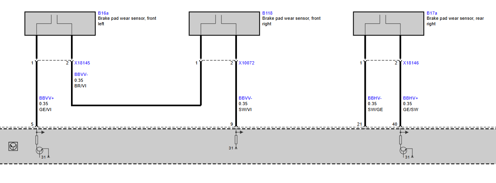

# Brake Pad Wear Sensors

On the E87 and E9x the DSC reads the brake pad wear sensors. It uses them, together with its own calculation of pad wear, for Condition Based Service (CBS). There is one sensor circuit for the front axle and one for the rear axle. On the E85/E86 the pins are not used (TIS).

## Wiring (E9x, MK60E5)

Each axle has a sensor loop from a DSC output ("A" in the BMW pinout for dsc_85/dsc_87) to a DSC input ("E"). On the front axle the loop runs through the front-left and front-right sensors in series. The BMW pinout names only "front left" for pins 5 and 9.

| Axle | DSC X18303 pin | Signal | Cross-section | Wire colour | Connection |
|---|---|---|---|---|---|
| front | 5 (output) | BBVV+ | 0.35 mm² | GE/VI | B16a front left, X18145 pin 1 |
| front | – | BBVV- | 0.35 mm² | BR/VI | B16a front left X18145 pin 2 → B118 front right X10072 pin 1 |
| front | 9 (input) | BBVV- | 0.35 mm² | SW/VI | B118 front right, X10072 pin 2 |
| rear | 40 (output) | BBHV+ | 0.35 mm² | GE/SW | B17a rear right, X18146 pin 2 |
| rear | 21 (input) | BBHV- | 0.35 mm² | SW/GE | B17a rear right, X18146 pin 1 |

Wire colours: GE yellow, VI violet, BR brown, SW black.

Signal names: BBV = Bremsbelagverschleiss (brake pad wear), V = front (vorne), H = rear (hinten).

## Evaluation in the DSC

From the DSC SGBD DSC_87.prg:

* Job `STATUS_CBS_SENSOR_BBV` reads the sensor state, one value for the front axle (VA) and one for the rear axle (HA). The job comment says the sensors have two wear thresholds ("2_stufig").
* Value table `CBS_BBV`:

  | Value | Meaning |
  |---|---|
  | 0x00 | OK |
  | 0x01 | first threshold reached |
  | 0x02 | not OK |
  | 0xFF | signal not available |

* Job `STATUS_CBS_BBV_DICKE` reads the calculated pad thickness and correction factors for each axle.
* Job `CBS_RESET` resets the CBS data after a pad change.
* Fault codes:
  * 5DE0 / 5DE1: pad wear front / rear not initialised or initialised incorrectly
  * 5DE2 / 5DE3: pad wear front / rear has reached critical thickness

## Wiring for standalone operation

These points have not been bench-tested.

* The sensors are optional for braking: the DSC uses them only for CBS service information. Pins 5, 9, 21 and 40 can stay unconnected if CBS isn't needed. Missing sensors will probably be read as "not OK" and may set faults 5DE2/5DE3.
* To avoid this, connect the original sensors (they don't have to be fitted to the pads), or try a bridge from pin 5 to pin 9 and from pin 40 to pin 21. The sensors have two thresholds, so a plain bridge may not read as OK. Check the result with `STATUS_CBS_SENSOR_BBV`.

The DSC unit side of the wiring is described in [DSC unit](DSCUnit.md#pin-functions).
