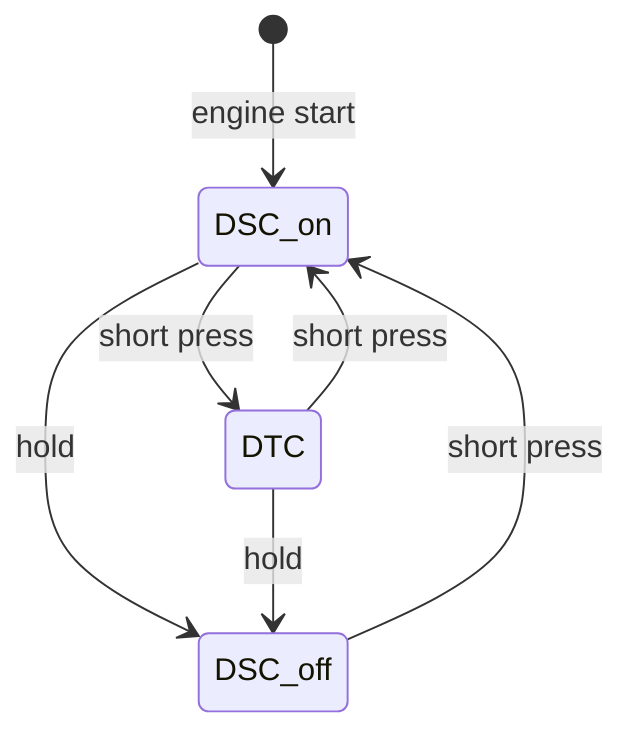
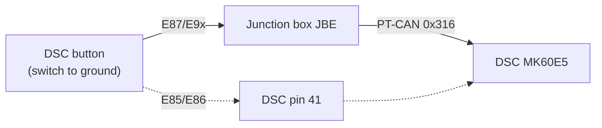
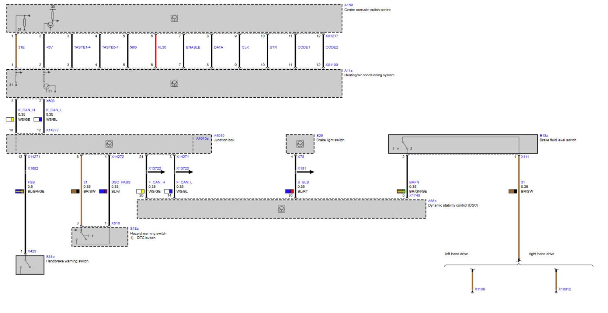

# DSC Button

The DSC button lets the driver choose how much the DSC intervenes. There is one button with three DSC modes; there is no separate DTC button.

## Names

BMW uses different names for the same button. This documentation uses "DSC button".

| BMW source | Name |
|---|---|
| Label on the button (E9x) | DSC OFF |
| TIS (English), system overview and function description | DTC button |
| Wiring diagram (E9x M3) | S18a hazard warning switch, footnote "DTC button"; signal DSC_PASS |
| SPdaten JBBF70.prg, CAN ID table | Bedienung Taster DSC (frame 0x316) |
| JBE SGBD JBBF87.prg, job `STATUS_DIGITAL_INPUTS` | DSC_BEFEHL "Sensor DSC Schalter", result `STAT_DSC_BEFEHL_EIN` ("DSC Taster") |
| DSC SGBD DSC_87.prg, job `STATUS_SCHALTER` | `STAT_DSC_TASTER_EIN` (button pressed) |
| DSC fault text 5E5B | DSC button |

## Installation location

From TIS:

* **E87, E90, E91, E92, E93:** in the centre console between the central air vents. The wiring diagram shows it as part of the hazard warning switch (S18a).
* **E85, E86:** in the centre console switch cluster (SZM).

## DSC modes

TIS lists three switching states:

1. DSC operational (standard setting)
2. DTC operational
3. DSC and DTC completely deactivated

DSC is active again after every engine start (TIS).

TIS gives no hold time (see [Open points](#open-points)).

DTC (Dynamic Traction Control) is a DSC variant tuned for traction (TIS):

* DTC is activated by deactivating DSC with the button.
* It brakes a spinning wheel to imitate a differential lock, which increases the drive torque on the wheel with more grip.
* Stabilising interventions (e.g. reduced engine power) come slightly later than with DSC, so the driver has to correct more.
* TIS recommends it only briefly: to rock the car free or pull away in deep snow or on a loose surface, on snowy uphill roads, in slush and with snow chains.

The DSC reports its current state in frame 0x19E (`STAT_DSC`), which the instrument cluster uses for the indicators. See [MK60E5 CAN interface](../MK60E5-CAN/MK60E5_DSC–CAN-Interface.md#pt-can--frames-sent-by-dsc).

## How the button reaches the DSC

### E87, E9x: through the JBE over PT-CAN

The button is a switch to ground wired to the junction box (JBE; TIS system circuit diagram, item 16).

E9x wiring diagram, drawn for the Bosch DSC 8 Plus. The DSC button (footnote 1, "DTC button") is part of the hazard warning switch S18a:

| S18a X516 pin | Signal | Cross-section | Wire colour | Connection |
|---|---|---|---|---|
| 1 | DSC_PASS (button signal) | 0.35 mm² | BL/VI | junction box A4010a X14272 pin 4 |
| 3 | 31 (ground) | 0.35 mm² | BR/SW | junction box A4010a X14272 pin 8 |

Wire colours: BL blue, VI violet, BR brown, SW black.

The DSC-side pin numbers in this diagram (F-CAN 26/14, brake light switch 30, brake fluid level 5) and the handbrake warning switch on the junction box belong to the Bosch DSC 8 Plus (variants dxc_70/dxc_90, all-wheel drive), not to the MK60E5. For the MK60E5 use the BMW pinout "A65a Dynamic stability control (DSC)", which applies to dsc_85 and dsc_87; see [DSC unit – pin functions](DSCUnit.md#pin-functions). The button wiring to the junction box is the same.

The button closes DSC_PASS to a ground supplied by the junction box. In this diagram it is not wired to the DSC, and in the dsc_85/dsc_87 pinout pin 41 is "Not used". Whether the M3 firmware actually uses 0x316 is open; see [Open points](#open-points).

The JBE SGBD (JBBF87.prg) lists the input as DSC_BEFEHL, "Sensor DSC Schalter", read through shift-register input 3. The level at the pin is 0 when the button is pressed and 1 when released. The result `STAT_DSC_BEFEHL_EIN` inverts this: 1 = pressed.

The JBE sends the button state to the DSC in frame **0x316** "Bedienung Taster DSC" on PT-CAN (SPdaten JBBF70.prg CAN ID table, sender JBBF). The DSC firmware 7846816A reads a 2-bit field at bit 0 of this 2-byte frame. The DSC doesn't supervise the frame: the DSC_87 supervision matrix defines no checksum, alive or timeout check for 0x316. The observed byte values and timing are in [MK60E5 CAN interface](../MK60E5-CAN/MK60E5_DSC–CAN-Interface.md#pt-can--frames-received-by-dsc).

The DSC decides the mode itself from how long the button is held.

### E85/E86: wired to DSC pin 41

On the Z4 the button is wired directly to DSC connector X18303 pin 41 ("DTC button in the SZM, input"). On the E87/E9x the BMW pinout lists pin 41 as not used. See [DSC unit – differences on the E85/E86](DSCUnit.md#differences-on-the-e85e86).

### Mode request 0x398

The DSC also receives frame 0x398 "Bedienung Fahrwerk" (chassis operation; SPdaten JBBF70.prg CAN ID table), which can request a DSC mode from the iDrive menu. The field layout is in [MK60E5 CAN interface](../MK60E5-CAN/MK60E5_DSC–CAN-Interface.md#pt-can--frames-received-by-dsc).

## Supervision

The DSC stores fault 5E5B "DSC button longer than 10 s pressed or errors" (DSC_87 fault texts). It detects a stuck or obstructed button this way.

## Diagnostics

| Control unit | Job | Result | Meaning |
|---|---|---|---|
| DSC (DSC_87.prg) | `STATUS_SCHALTER` (`6F1: 29 02 21 05`) | `STAT_DSC_TASTER_EIN` | DSC has received a button press |
| DSC (DSC_87.prg) | `STATUS_SCHALTER` | `STAT_DSC_PASSIV` | DSC switched off |
| JBE (JBBF87.prg) | `STATUS_DIGITAL_INPUTS` | `STAT_DSC_BEFEHL_EIN` | JBE sees the button pressed |

The DSC job shows the button state as the DSC sees it, whichever input it comes from. See [MK60E5 CAN interface – diagnostics](../MK60E5-CAN/MK60E5_DSC–CAN-Interface.md#diagnostics-over-pt-can-on-the-bench).

## Wiring for standalone operation

These points follow from the BMW sources above. They have not been bench-tested.

* **Button:** a momentary switch to ground, as in the car. Without a JBE, your own electronics must read it and send frame 0x316 while it is pressed. The DSC then times the hold itself.
* **Pin 41:** "Not used" in the BMW pinout for dsc_85/dsc_87, but possibly read by the M3 firmware (see [Open points](#open-points)). For the bench test, wire the button to your CAN electronics and, through a jumper, to pin 41.
* **Indicators:** on the E9x the DSC has no lamp output (pin 44 is used only on the E85/E86). Drive the DSC OFF and DTC lamps from frame 0x19E.
* **Without a button:** DSC is on after every engine start, so no button is needed for normal operation.

## Open points

* Hold time for DSC off: not stated in TIS. It is given in the BMW owner's handbook, which has not been checked for this page.
* **Which input the M3 firmware uses (conflict).** The BMW pinout for dsc_85/dsc_87 lists pin 41 as not used, and the E9x wiring sends the button through the JBE in 0x316. An independent disassembly of firmware 7846816A ([cmg5461/mk60e5-firmware](https://github.com/cmg5461/mk60e5-firmware), `FACTS.md`, "DSC driver mode") finds a different picture:
  * The DSC mode logic reads a **hardwired, active-low button** on a digital input next to the brake light switch input. Holding it 0.5 s switches DSC off, 0.15 s switches it back on, and 10 s sets fault 5E5B.
  * 0x316 is not tied to that logic; its value goes to a variable whose use was not identified.
  * The firmware doesn't reveal the pin. Pin 41, the E85/E86 button input on the same connector, is the likely candidate.

  **Bench test:** with nothing on pin 41, send 0x316 (`FD FF` while pressed) and read `STATUS_SCHALTER` and frame 0x19E. Then pull pin 41 to ground through the button and repeat. Then send 0x398 (DSC off request) and repeat.
