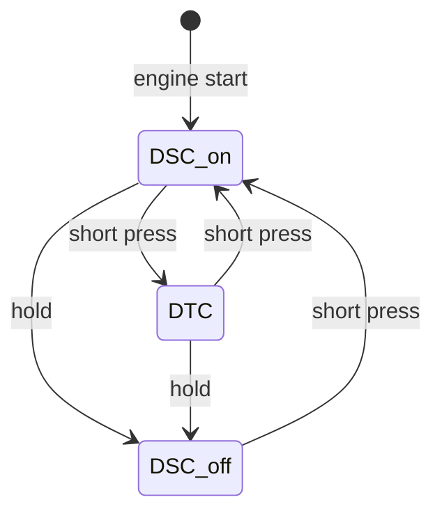
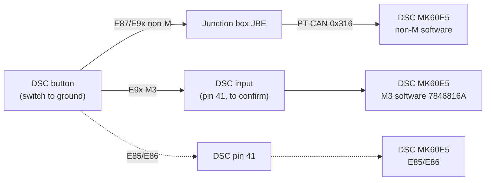

# DSC Button

The DSC button lets the driver choose how much the DSC intervenes. There is one button with three DSC modes; there is no separate DTC button.

## Names

BMW uses different names for the same button. This documentation uses "DSC button".

| BMW source | Name |
|---|---|
| Label on the button (E9x) | DSC OFF |
| TIS (English), system overview and function description | DTC button |
| Wiring diagram (E9x, drawn for the Bosch DSC 8 Plus) | S18a hazard warning switch, footnote "DTC button"; signal DSC_PASS |
| SPdaten JBBF70.prg, CAN ID table | Bedienung Taster DSC (frame 0x316) |
| JBE SGBD JBBF87.prg, job `STATUS_DIGITAL_INPUTS` | DSC_BEFEHL "Sensor DSC Schalter", result `STAT_DSC_BEFEHL_EIN` ("DSC Taster") |
| DSC SGBD DSC_87.prg, job `STATUS_SCHALTER` | `STAT_DSC_TASTER_EIN` (button pressed) |
| DSC fault text 5E5B | DSC button |

## Installation location

From TIS:

* **E87, E90, E91, E92, E93:** in the centre console between the central air vents. The wiring diagram shows it as part of the hazard warning switch (S18a).
* **E85, E86:** in the centre console switch cluster (SZM).

## DSC modes

TIS lists three switching states:

1. DSC operational (standard setting)
2. DTC operational
3. DSC and DTC completely deactivated

DSC is active again after every engine start (TIS).

TIS gives no hold time. The DSC firmware does: each variant has a button transition table, counted in 10 ms cycles (1000 cycles = the 10 s of fault 5E5B):

| Transition | Non-M, 6862873A (table 0xDC78C) | M3, 7846816A (table 0xDA1BC) |
|---|---|---|
| on → DTC / M Dynamic Mode | short press (on release) | **none**: the button never selects M Dynamic Mode |
| on → off | held 250 cycles = **2.5 s** | held 50 cycles = **0.5 s** |
| off (or DTC) → on | press | held 15 cycles = 0.15 s |
| button stuck | held 1000 cycles = 10 s, fault 5E5B | the same |

On the M3, M Dynamic Mode is selected through the M Drive (frames 0x398/0x399), not with the DSC button. The state diagram above is the non-M (TIS) behaviour. The counts were read from the stock tables in the BMW flash files; the non-M row meanings are read from the table layout and not replayed.

DTC (Dynamic Traction Control) is a DSC variant tuned for traction (TIS):

* DTC is activated by deactivating DSC with the button.
* It brakes a spinning wheel to imitate a differential lock, which increases the drive torque on the wheel with more grip.
* Stabilising interventions (e.g. reduced engine power) come slightly later than with DSC, so the driver has to correct more.
* TIS recommends it only briefly: to rock the car free or pull away in deep snow or on a loose surface, on snowy uphill roads, in slush and with snow chains.

The DSC reports its current state in frame 0x19E (`STAT_DSC`), which the instrument cluster uses for the indicators. See [MK60E5 CAN interface](../MK60E5-CAN/MK60E5_DSC–CAN-Interface.md#pt-can--frames-sent-by-dsc).

## How the button reaches the DSC

It depends on the DSC software, not only on the car:

### E87, E9x non-M: through the JBE over PT-CAN

The button is a switch to ground wired to the junction box (JBE; TIS system circuit diagram, item 16).

E9x wiring diagram, drawn for the Bosch DSC 8 Plus. The DSC button (footnote 1, "DTC button") is part of the hazard warning switch S18a:

| S18a X516 pin | Signal | Cross-section | Wire colour | Connection |
|---|---|---|---|---|
| 1 | DSC_PASS (button signal) | 0.35 mm² | BL/VI | junction box A4010a X14272 pin 4 |
| 3 | 31 (ground) | 0.35 mm² | BR/SW | junction box A4010a X14272 pin 8 |

Wire colours: BL blue, VI violet, BR brown, SW black.

The DSC-side pin numbers in this diagram (F-CAN 26/14, brake light switch 30, brake fluid level 5) and the handbrake warning switch on the junction box belong to the Bosch DSC 8 Plus (variants dxc_70/dxc_90, all-wheel drive), not to the MK60E5. For the MK60E5 use the BMW pinout "A65a Dynamic stability control (DSC)", which applies to dsc_85 and dsc_87; see [DSC unit – pin functions](DSCUnit.md#pin-functions). The button wiring to the junction box is the same.

The button closes DSC_PASS to a ground supplied by the junction box. In this diagram it is not wired to the DSC, and in the dsc_85/dsc_87 pinout pin 41 is "Not used". This is the non-M arrangement; the M3 differs (see [E9x M3](#e9x-m3-wired-to-the-dsc)).

The JBE SGBD (JBBF87.prg) lists the input as DSC_BEFEHL, "Sensor DSC Schalter", read through shift-register input 3. The level at the pin is 0 when the button is pressed and 1 when released. The result `STAT_DSC_BEFEHL_EIN` inverts this: 1 = pressed.

The JBE sends the button state to the DSC in frame **0x316** "Bedienung Taster DSC" on PT-CAN (SPdaten JBBF70.prg CAN ID table, sender JBBF). The DSC reads a 2-bit field at bit 0 of this 2-byte frame. The DSC doesn't supervise the frame: the DSC_87 supervision matrix defines no checksum, alive or timeout check for 0x316. The observed byte values and timing are in [MK60E5 CAN interface](../MK60E5-CAN/MK60E5_DSC–CAN-Interface.md#pt-can--frames-received-by-dsc).

In the non-M firmware 6862873A the button logic takes its input from this frame: the 0x316 handler stores the state at RAM 0x4013C4, and the button getter (0x945D0) reads it from there.

The DSC decides the mode itself from how long the button is held.

### E9x M3: wired to the DSC

The M3 firmware 7846816A reads the button on its own input pin and ignores 0x316. Found in the BMW flash file with the cmg5461 disassembler (see Sources below):

| Finding | Evidence in 7846816A |
|---|---|
| The button is a port input of the DSC microcontroller, active low (pressed = pulled to ground) | getter 0x6FEE4 reads port register 0xDE0018 bit 1 (copied to RAM 0x4009F4), next to the brake light switch (bit 0); the non-M firmware has no getter for this bit |
| The mode logic uses this input | the button state machine (0x8D214) gets button 0 through 0x8D542 → 0x8D52C → 0x6FEE4 |
| BMW's diagnostic job reports this input | `STATUS_SCHALTER` response bit 2 (`STAT_DSC_TASTER_EIN`, decoded from DSC_87.prg) is built by 0xB184A from the same button 0 |
| 0x316 is not used | the 0x316 handler stores the state at RAM 0x401108, and nothing reads it apart from the CAN housekeeping (received/invalid flags) |

The firmware doesn't show which connector pin the port input is on. Pin 41 is the likely one: on the E85/E86 the same connector has the "DTC button in the SZM" on pin 41. Confirm on the bench (see [Open points](#open-points)).

### E85/E86: wired to DSC pin 41

On the Z4 the button is wired directly to DSC connector X18303 pin 41 ("DTC button in the SZM, input"). On the E87/E9x non-M the BMW pinout lists pin 41 as not used. See [DSC unit – differences on the E85/E86](DSCUnit.md#differences-on-the-e85e86).

### Mode request 0x398

The DSC also receives frame 0x398 "Bedienung Fahrwerk" (chassis operation; SPdaten JBBF70.prg CAN ID table), which can request a DSC mode from the iDrive menu. The field layout is in [MK60E5 CAN interface](../MK60E5-CAN/MK60E5_DSC–CAN-Interface.md#pt-can--frames-received-by-dsc).

## Supervision

The DSC stores fault 5E5B "DSC button longer than 10 s pressed or errors" (DSC_87 fault texts). It detects a stuck or obstructed button this way.

## Diagnostics

| Control unit | Job | Result | Meaning |
|---|---|---|---|
| DSC (DSC_87.prg) | `STATUS_SCHALTER` (`6F1: 29 02 21 05`) | `STAT_DSC_TASTER_EIN` | DSC has received a button press |
| DSC (DSC_87.prg) | `STATUS_SCHALTER` | `STAT_DSC_PASSIV` | DSC switched off |
| JBE (JBBF87.prg) | `STATUS_DIGITAL_INPUTS` | `STAT_DSC_BEFEHL_EIN` | JBE sees the button pressed |

The DSC job shows the button state as the DSC sees it: on the non-M from 0x316, on the M3 from the wired input. `STATUS_SCHALTER` returns one data byte (`61 05 xx`):

| Bit | Result | Source in 7846816A |
|---|---|---|
| 0 | `STAT_BREMSLICHT_SCHALTER_EIN` | port byte 0 bit 0 (active high) |
| 1 | `STAT_BREMSFLUESSIGKEIT_NIVEAU_SCHALTER_EIN` | port byte 1 bit 5 (active high) |
| 2 | `STAT_DSC_TASTER_EIN` | DSC button input, port byte 0 bit 1 (active low) |
| 3 | `STAT_DSC_PASSIV` | driver mode not on and not M Dynamic Mode |
| 4 | `STAT_HANDBREMSE_SCHALTER_EIN` | port byte 1 bit 1 (active low) |
| 5 | `STAT_RPA_RESET_TASTER_EIN` | second button (RAM 0x401109, only cleared at start-up) |
| 6 | `STAT_DFA_WERK_MODE` | 0x71FBA |
| 7 | `STAT_RPA_EOL_PASSIV` | 0x9BD9C |

See [MK60E5 CAN interface – diagnostics](../MK60E5-CAN/MK60E5_DSC–CAN-Interface.md#diagnostics-over-pt-can-on-the-bench).

## Wiring for standalone operation

These points follow from the BMW sources and firmware above. They have not been bench-tested.

* **M3 unit (7846816A, this project):** wire a momentary switch between the DSC button input (pin 41, to be confirmed) and ground. Sending 0x316 has no effect on this software. Hold 0.5 s for DSC off; press again for DSC on.
* **Non-M unit:** the button goes to your own electronics, which send 0x316 (`FD FF` while pressed, `FC FF` after release). The DSC times the hold itself.
* **Without a button, either software:** frame 0x398 requests the mode directly (DSC on / off / M Dynamic Mode); see [MK60E5 CAN interface](../MK60E5-CAN/MK60E5_DSC–CAN-Interface.md#practical-notes-for-standalone-operation-inference).
* **Indicators:** on the E9x the DSC has no lamp output (pin 44 is used only on the E85/E86). Drive the DSC OFF and DTC lamps from frame 0x19E.
* **No button at all:** DSC is on after every engine start, so no button is needed for normal operation.

## Open points

* **Pin of the M3 button input.** The firmware shows a dedicated, active-low input; the pin is most likely 41 (E85/E86 button pin). A non-BMW source agrees: the superwofy E9x M integration (MIT) wires the M3 DSC button to pin 41 and disables the JBE's DSC switch handling (JBE coding `DSC_SWITCH`) for the M3 hazard switch cluster. Bench test: power the unit, connect pin 41 to ground through the button and read `STATUS_SCHALTER`; bit 2 (`STAT_DSC_TASTER_EIN`) must follow the button, and after a 0.5 s hold bit 3 (`STAT_DSC_PASSIV`) must set. If bit 2 doesn't follow, check whether the input needs an external pull-up (superwofy notes that non-M units flashed with M3 software need a 12 V pull-up).

## Sources for the firmware findings

The firmware findings come from the BMW flash files `Shared/SP-Daten/E89/E89/data/DSCM90/7846816A.0pa` (M3) and `.../DSC90/6862873A.0pa` (non-M), disassembled with the tools of [cmg5461/mk60e5-firmware](https://github.com/cmg5461/mk60e5-firmware) (MIT), whose analysis first pointed to the hardwired input. Addresses are CPU addresses (file offset − 0x8000).
