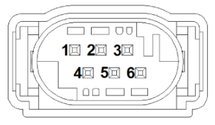
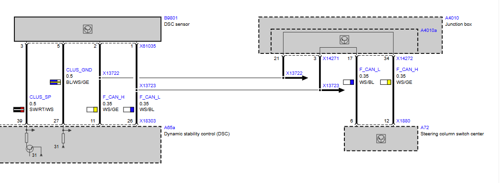

# DSC Sensor

The DSC sensor (B9801) measures the yaw rate (rotation around the vertical axis) and the lateral acceleration of the vehicle. It sends both to the DSC over F-CAN.

## Installation location

* **E87, E90, E91, E92, E93:** on the seat cross-member under the driver's seat. Cars with Active Steering use a separate, redundant DSC sensor.
* **E85, E86:** on the floor under the front-passenger seat. Here the DSC sensor has its own private CAN to the DSC, and nothing else is connected to it.

The sensor measures movement around the vehicle axes, so in a standalone installation it should be mounted flat and in the same orientation as in the car.

## Variants

| Variant | Used on | Construction |
|---|---|---|
| Simple | cars **without** Active Steering | sensor element with 2 rotation-rate sensors; CAN board with 1 acceleration sensor and 1 rotation-rate sensor |
| Redundant | cars **with** Active Steering | sensor element with 2 rotation-rate sensors; CAN board with 2 acceleration sensors. Delivers 2 yaw-rate and 2 lateral-acceleration signals |

On the E87 and E9x the longitudinal-acceleration sensor is on the board of the DSC unit. On the E85/E86 it is part of the DSC sensor.

The DSC reads the sensor type from the sensor over CAN: 1 = VDO single, 2 = Systron Donner single, 3 = Systron Donner redundant. The CAN frames are described in [MK60E5 CAN interface](../MK60E5-CAN/MK60E5_DSC–CAN-Interface.md#f-can).

## Sensor used in this project

BMW 34 52 6 781 575 (label "SENSORCLUSTER 03", ATE 10.1701-0384.3). BMW ETK lists it as follows:

| Item | ETK data |
|---|---|
| Production | from May 2007 |
| Old part number | 34 52 6 762 769 |
| Interchangeability | not exchangeable retrospectively |
| Usage | 1 Series: E81, E82, E87, E87 Facelift, E88; 3 Series: E90, E91, E92, E93 |
| Note | limited storage life |

## Wiring

### Connector view

Connector X61035, 6-pin (connector view E87_SX61035A).

### Wiring diagram

Pin assignments at plug connector X61035 (DSC sensor B9801):

| Pin | Signal | Cross-section | Wire colour | Connection |
| :-- | :----- | :------------ | :---------- | :--------- |
| 1 | F_CAN_L | 0.35 mm² | WS/BL | DSC X18303 pin 26; splice X13723 to the junction box |
| 2 | F_CAN_H | 0.35 mm² | WS/GE | DSC X18303 pin 11; splice X13722 to the junction box |
| 3 | CLUS_SP (supply) | 0.5 mm² | SW/RT/WS | DSC X18303 pin 39. The DSC switches the sensor supply |
| 4 | -- | | | Not used |
| 5 | CLUS_GND (ground) | 0.5 mm² | BL/WS/GE | DSC X18303 pin 27. Ground through the DSC |
| 6 | -- | | | Not used |

Wire colours: SW black, RT red, WS white, BL blue, GE yellow.

In the car the junction box (A4010a) links this F-CAN segment to the steering column switch cluster (SZL, A72):

| Signal | DSC sensor / DSC splice | Junction box in | Junction box out | SZL X1880 |
|---|---|---|---|---|
| F_CAN_H (WS/GE) | X13722 | X14271 pin 21 | X14272 pin 34 | pin 12 |
| F_CAN_L (WS/BL) | X13723 | X14271 pin 3 | X14272 pin 17 | pin 6 |

## Wiring for standalone operation

These points follow from the wiring diagram. They have not been bench-tested.

* **Power:** the sensor needs no separate supply. It is powered and grounded by the DSC (pins 39 and 27).
* **F-CAN:** without the junction box, connect the three F-CAN nodes directly with a twisted pair:
  * F_CAN_H: DSC pin 11, DSC sensor pin 2, SZL X1880 pin 12
  * F_CAN_L: DSC pin 26, DSC sensor pin 1, SZL X1880 pin 6
* **Termination:** the diagram doesn't show where the F-CAN terminating resistors are. With all nodes connected and unpowered, measure the resistance between F_CAN_H and F_CAN_L: about 60 Ω means both terminations are present, about 120 Ω means one is missing, and open circuit means none. Add 120 Ω at a bus end for each missing one.

The DSC unit side of the wiring is described in [DSC unit](DSCUnit.md#pin-functions).
