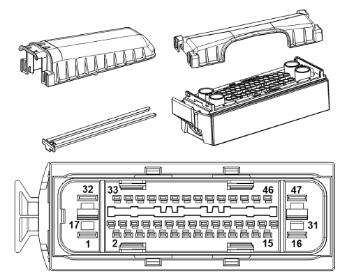

# DSC Unit

The DSC unit (A65a) is the Continental Teves MK60E5. It combines three parts:

* the DSC control unit;
* the DSC hydraulic unit with the solenoid valves;
* the return pump.

All 5 brake pressure sensors are in the DSC unit. On the E87 and E9x the board of the control unit also carries the longitudinal-acceleration sensor, so the unit must be mounted in its original orientation.

## Installation location

* **E87, E90, E91, E92, E93:** LHD cars: front left in the water box, under a cover panel next to the brake-fluid expansion tank. RHD cars: front right in the water box, turned through 90°.
* **E85, E86:** LHD cars: front left, under the electronics box next to the suspension strut dome. RHD cars: front right next to the suspension strut dome, turned through 90°.

## Construction

The control unit sits on the hydraulic unit. From the TIS exploded view:

* **Hydraulic unit:** solenoid valves, contacts for the brake pressure sensors, and the 47-pin connector for the control unit.
* **Control unit:** housing, board, heat sink and a spring element.

## Unit used in this project

The unit in the photos ([Components/DSC](../Components/DSC)) is the M3 version, labelled BMW 34 51 7 846 816-01, ATE 10.0212-0801.4. The controller label reads 10.0961-0883.3 / 10.0619-3868.1 / 28.5612-6200.3, "7 846 816 Steuergeraet DSC", made in Hungary. Its firmware is 7846816A (SG type `DSCM90`). The ETK part numbers of all variants are listed in the [README](../README.md#dsc-unit).

### LHD or RHD?

The part number doesn't tell whether a unit comes from a left-hand-drive or right-hand-drive car. BMW built one DSC unit for every E9x M3:

* **One series of numbers.** The BMW programming data (SPdaten, `DSCM90.HIS`) lists a single series of M3 DSC numbers, each replacing the one before: 4791200 → 7838677 → 7840955 → 7841109 → 7841232 → 7841954 → 7842458 → 7844050 → 7844739 → **7846816**. There is no separate LHD or RHD version. 7846816 is the last in the series and replaces all older ones. The ETK numbers 34507841233 and 34507841955 belong to the same series.
* **No steering-side coding.** The M3 coding data (`MK60_M3.C08`) has no LHD/RHD parameter.
* **Same mounting parts.** The ETK diagram "Hydro unit DSC/fastening/sensors" (illustration 164487) is identical for LHD and RHD on the E92 M3 (Europe, 2011). The RHD unit is turned through 90° in the water box (TIS), but the diagram shows the same mounting parts.

To find out where a unit came from, read the VIN it stores (the VIN of the car it was coded for). Use the SGBD job `C_FG_LESEN` or `IDENT_VIN`, or send the request directly over PT-CAN (see [Diagnostics over PT-CAN on the bench](../MK60E5-CAN/MK60E5_DSC–CAN-Interface.md#diagnostics-over-pt-can-on-the-bench)). A VIN decoder then shows the original car, including whether it was LHD or RHD.

## Connector view

Connector X18303, 47-pin natural

Pin assignments at plug connector X18303 (E87/E9x). Type: E = input, A = output, E/A = input and output, M = ground. The table follows the 2009 M3 sheet, which marks the supply pins 1, 17 and 32 and all wheel sensor pins as inputs (E); the TIS functional description marks the supply pins as V (supply) and the wheel sensor supply pins as outputs (A).

| Pin | Type | Description /Signal type                   | Connection /Measuring notes                |
| :-- | :--- | :----------------------------------------- | :----------------------------------------- |
| 1   | E    | Supply, terminal 30                        | Fuse F65                                   |
| 2   | --   | Not used                                   |                                            |
| 3   | E    | Signal, brake fluid level                  | Brake fluid level switch                   |
| 4   | E    | Brake light switch signal                  | Brake light switch                         |
| 5   | A    | Signal Brake pad wear sensor, front left   | Brake pad wear sensor, front left          |
| 6   | --   | Not used                                   |                                            |
| 7   | --   | Not used                                   |                                            |
| 8   | A    | Signal, processed wheel speed, rear right  | Connector X10186 (rear right wheel speed)  |
| 9   | E    | Signal Brake pad wear sensor, front left   | Brake pad wear sensor, front left          |
| 10  | --   | Not used                                   |                                            |
| 11  | E/A  | Signal F-CAN high                          | CAN-bus connector                          |
| 12  | A    | Signal, processed wheel speed, front right | Connector X10184 (front right wheel speed) |
| 13  | --   | Not used                                   |                                            |
| 14  | A    | Signal, processed wheel speed, front left  | Connector X10183 (front left wheel speed)  |
| 15  | E/A  | Signal PT-CAN low                          | CAN-bus connector                          |
| 16  | M    | Ground                                     | Ground point                               |
| 17  | E    | Signal, terminal 30G                       | Fuse F20                                   |
| 18  | --   | Not used                                   |                                            |
| 19  | --   | Not used                                   |                                            |
| 20  | --   | Not used                                   |                                            |
| 21  | E    | Signal Brake pad wear sensor, rear right   | Brake pad wear sensor, rear right          |
| 22  | --   | Not used                                   |                                            |
| 23  | --   | Not used                                   |                                            |
| 24  | --   | Not used                                   |                                            |
| 25  | A    | Conditioned wheel speed signal             | Car access system                          |
| 26  | E/A  | Signal F-CAN low                           | CAN-bus connector                          |
| 27  | M    | Ground DSC sensor                          | DSC sensor                                 |
| 28  | --   | Not used                                   |                                            |
| 29  | E    | Wake-up signal, terminal 15                | Connector, terminal 15 wake-up             |
| 30  | E/A  | Signal PT-CAN high                         | CAN-bus connector                          |
| 31  | --   | Not used                                   |                                            |
| 32  | E    | Supply, terminal 30                        | Fuse F31                                   |
| 33  | E    | Signal, front right wheel speed            | Front right wheel speed sensor             |
| 34  | E    | Signal, front right wheel speed            | Front right wheel speed sensor             |
| 35  | --   | Not used                                   |                                            |
| 36  | E    | Signal, rear left wheel speed              | Rear left wheel speed sensor               |
| 37  | E    | Signal, rear left wheel speed              | Rear left wheel speed sensor               |
| 38  | E    | Signal Handbrake warning switch            | Handbrake warning switch                   |
| 39  | A    | Supply DSC sensor                          | DSC sensor                                 |
| 40  | A    | Signal Brake pad wear sensor, rear right   | Brake pad wear sensor, rear right          |
| 41  | --   | Not used                                   |                                            |
| 42  | E    | Signal, rear right wheel speed             | Rear right wheel speed sensor              |
| 43  | E    | Signal, rear right wheel speed             | Rear right wheel speed sensor              |
| 44  | --   | Not used                                   |                                            |
| 45  | E    | Signal, front left wheel speed             | Front left wheel speed sensor              |
| 46  | E    | Signal, front left wheel speed             | Front left wheel speed sensor              |
| 47  | M    | Ground                                     | Ground point                               |

## Pin functions

The table below groups the pins by function. It comes from the TIS E9x pinout ("DSC unit" / "A65a"). The BMW pinout "A65a Dynamic stability control (DSC)" for the MK60E5 variants dsc_85 and dsc_87 agrees for every pin, and lists pins 2, 6, 7, 10, 13, 18–20, 22–24, 28, 31, 35, 41 and 44 as not used. The 2009 M3 Prodemand sheet agrees too. The Bosch DSC 8 Plus of all-wheel-drive cars (dxc_70, dxc_90) has a different pinout. The table also tells which pin of each wheel sensor and brake pad wear sensor pair is the supply and which is the signal.

| Pin | Function | Pin | Function |
|---|---|---|---|
| 1 | KL30 return pump (fuse F65) | 47 | KL31 return pump |
| 32 | KL30 solenoid valves (fuse F31) | 16 | KL31 solenoid valves |
| 17 | KL30g active (fuse F20) | 29 | **KL15 wake-up wire** |
| 30 / 15 | PT-CAN high / low | 11 / 26 | F-CAN high / low |
| 39 / 27 | DSC sensor supply / ground | 4 | brake light switch |
| 3 | brake-fluid level switch (low fluid → DSC off) | 38 | parking-brake warning switch (no regulation during a handbrake turn; disables the start-off assistant) |
| 45 / 46 | wheel sensor FL supply / signal | 34 / 33 | wheel sensor FR supply / signal |
| 36 / 37 | wheel sensor RL supply / signal | 43 / 42 | wheel sensor RR supply / signal |
| 5 / 9 | brake pad wear front axle output / input (front left and, if fitted, front right in series) | 40 / 21 | brake pad wear rear (RR) output / input |
| 8 | wheel-speed output RR → DME/DDE | 14 | wheel-speed output FL → M-ASK/CCC (US without nav: TCU) |
| 12 | wheel-speed output FR → TCU (US without nav only) | 25 | speed output → CAS (steering lock) |

### Differences on the E85/E86

The E85/E86 (Z4) uses the same connector with some pins assigned differently (TIS):

| Pin | E85, E86 | E87, E9x |
|---|---|---|
| 2 | TxD data wire (TxD1), output | not used |
| 5, 9, 21, 40 | not used (brake pad wear is E87/E9x only) | brake pad wear sensors |
| 6 | RPA button in the centre console switch cluster (SZM), input | not used |
| 8 | wheel-speed output RR → DME and navigation system | wheel-speed output RR → DME/DDE |
| 10 | wheel-speed output RL → instrument cluster | not used |
| 11 / 26 | separate CAN high / low (DSC sensor only) | F-CAN high / low |
| 14 | wheel-speed output FL → TCU (US without nav only) | wheel-speed output FL → M-ASK/CCC (US without nav: TCU) |
| 17 | terminal 30 | terminal 30g, active |
| 29 | terminal 15 | terminal 15 wake-up wire |
| 41 | DSC button input (TIS: "DTC button in the SZM", E85/E86 only) | not used (non-M); **E9x M3: most likely the DSC button input**, see [DSC button](DSCButton.md#e9x-m3-wired-to-the-dsc) |
| 44 | ABS indicator and warning light in the instrument cluster, output | not used |

On the E87/E9x the DSC and RPA buttons and the warning lights are not wired to the DSC; they are exchanged over PT-CAN. The DSC button is described in [DSC button](DSCButton.md).

## Wiring for standalone operation

These points follow from the TIS wiring and the DSC firmware. They have not been bench-tested.

* **Power:** three separate supplies, as in the car: return pump (pin 1 from fuse F65, ground pin 47), solenoid valves (pin 32 from fuse F31, ground pin 16) and the electronics (pin 17, terminal 30g from fuse F20). The pump and valves draw high current; the connector parts list includes larger ELO-Power contacts, presumably for pins 1, 32, 16 and 47 (see [Connectors](#connectors)).
* **KL15 wake-up:** the DSC wakes on pin 29, not on bus activity, so pin 29 must be wired to terminal 15.
* **Two high-speed CAN channels:** one for PT-CAN (pins 30/15) and one for F-CAN (pins 11/26), each terminated with 120 Ω at both ends.
  K-CAN uses a different, incompatible transceiver and termination, but the DSC never connects to it.
* **DSC sensor:** powered and grounded by the DSC (pins 39/27); see [DSC sensor](DSCSensor.md#wiring).
* **Wheel speed sensors:** two-wire active sensors, supplied by the DSC; see [Wheel speed sensors](WheelSpeedSensors.md).
* **Switches:** brake light switch (pin 4), brake-fluid level switch (pin 3) and parking-brake warning switch (pin 38). A low brake-fluid level switches DSC off; the parking-brake switch blocks regulation during a handbrake turn and disables the start-off assistant.
* **Optional outputs:** brake pad wear sensors (pins 5/9, 40/21; see [Brake pad wear sensors](BrakePadWearSensors.md)) and the wheel-speed outputs (pins 8, 12, 14, 25) can stay unconnected if nothing uses them. Missing pad wear sensors may set a fault (not tested).

The CAN content and the frames that must be emulated are described in [MK60E5 CAN interface](../MK60E5-CAN/MK60E5_DSC–CAN-Interface.md#practical-notes-for-standalone-operation-inference).

## Connectors

|Element|BMW P/N | Quantity |
|---|---|---|
|Socket housing |61136954574 | |
|Slider blue |61136901739 | |
|Terminal socket MQS ELA |61136901726 | |
|Sealing grommet |61138366245 | |
|Socket contact ELO-Power 5, 2x0, 63 |61138364846 | |
|Sealing grommet ELO-Power 5, 2 x 0, 63 |61138372628 | |

