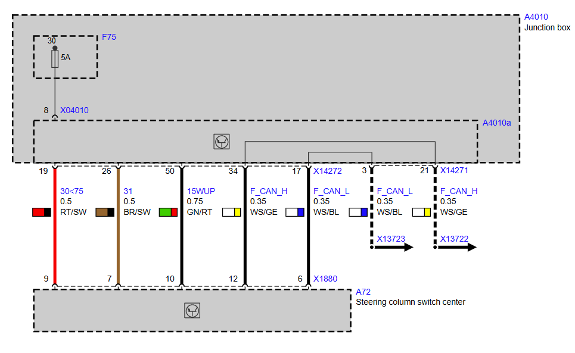

# Steering Column Switch Cluster (SZL)

The steering column switch cluster (BMW: Schaltzentrum Lenksäule, SZL; in the BMW CAN tables `SZL_LWS`) holds the steering angle sensor (LWS), the stalks (turn signal/high beam, wiper, cruise control) and the connection for the steering-wheel buttons. On the E8x/E9x it is a node on **F-CAN only**. The DSC reads the steering angle directly and copies the other SZL frames to PT-CAN; the JBE copies some of them on to K-CAN (see [SZL and JBE](#szl-and-jbe)).

## Unit used in this project

E92 M3 SZL (photos in [Components/SZL](../Components/SZL)), all parts dated 20.12.2007:

| Part | BMW number | Supplier number | Notes |
|---|---|---|---|
| SZL assembly | LZ 9 123 060-02 | Kostal 10 0016 32-01 | HW 27 / SW 68 |
| Electronics module | – | Kostal 392 00 2082 33-02 | HW 027 / SW 068 |
| Clock spring | 6 989 557-02 | Kostal 04308135-03 | |
| Stalk modules | 01 3081 50, 01 1081 60, 01 2081 95 | | Z1 |

## Diagnostics: through the DSC

The E8x/E9x SZL has no diagnostic description (SGBD) of its own: the BMW group table (`T_GRTB.prg`) lists SZL SGBDs only for E60, E65 and R56, and none of the E89 SPdaten SGBDs describes it. Its diagnostics are part of the DSC SGBD `DSC_87.prg`:

| Job (DSC_87.prg) | Request | What it does |
|---|---|---|
| `STATUS_IDENT_SZL` | `22 16 01` | SZL identification: location, hardware number, serial number, type (00 without, 01 with Active Steering) |
| `STATUS_F_CAN_LW` | `22 00 C9` | Steering angle as received in 0x0C9 |
| `STATUS_F_CAN_TEMPOMAT_ACC`, `STATUS_F_CAN_TASTER_AUDIO_TEL`, `STATUS_F_CAN_WISCHERTASTER` | `22 01 94`, `22 01 D6`, `22 02 A6` | Cruise stalk, steering-wheel buttons, wiper stalk as received |
| `LENKWINKEL_DSC_ABGLEICHEN` | `31 21 00` | Steering angle zero calibration (wheels straight) – stored in the DSC |
| `_COD_SCHREIBEN_SZL` | `2E 30 01` | Writes the SZL variant byte in the DSC coding (block 0x3001). Only the non-M coding `MK60_87` has this parameter (2 = E8x, 4 = E8x + AFS, 5 = E9x, 7 = AFS); the M3 coding `MK60_M3` has no SZL parameter |

The DSC fault memory includes the SZL's faults (DSC_87 fault texts):

| Codes | Meaning |
|---|---|
| 0x94B0–0x94C9, 0x94E0, 0x94E1 | steering angle sensor internal faults (sensor synchronisation, reference track, code disc, EEPROM, not calibrated) |
| 0x9500–0x9503 | SZL undervoltage (< 8.5 V) / overvoltage (> 16.5 V) |
| 0x9510–0x9512, 0x9518–0x951A, 0x9520 | cruise stalk, wiper stalk and steering-wheel (MFL) buttons: stuck, implausible or electrically defective |
| 0xC987 | F-CAN SZL bus off |
| 0xC994–0xC99C | the SZL misses DSC frames: wheel speed (0x0CE), wheel tolerance (0x374), sync (0x080), terminal status (0x130) |
| 0xD373 | the DSC misses the SZL steering angle (0x0C8/0x0C9) |

## CAN messages

Frame names and senders are from the BMW CAN ID table in the JBE SGBD (SPdaten `JBBF70.prg`, table `ZUORDNUNG_CAN_ID_SG`); signal layouts are in [MK60E5 CAN interface – F-CAN](../MK60E5-CAN/MK60E5_DSC–CAN-Interface.md#f-can) and the F-CAN DBC.

### Sent by the SZL (F-CAN)

| ID | BMW name | Used by | Also on | Content |
|---|---|---|---|---|
| 0x0C8 | Lenkradwinkel Oben F-CAN | DSC (supervised, D373), others | PT-CAN and K-CAN, **DLC 6** | steering angle 16 bit × 0.04395 °, alive counter, steering speed |
| 0x0C9 | Lenkradwinkel Oben 2 F-CAN | DSC | – (F-CAN only) | steering angle 16 bit × 0.04395 ° (scaling verified by running the DSC_87 job code), status, alive counter. The DSC's steering input |
| 0x194 | Bedienung Tempomat/ACC | DSC, DME | PT-CAN | cruise control stalk |
| 0x1D6 | Bedienung Taster Audio/Telefon | radio, telephone | PT-CAN and K-CAN | steering-wheel buttons (volume, search, telephone, voice) |
| 0x1D9 | Bedienung Taster M-Drive | DME (M3) | PT-CAN (DSC, M3 software only); K-CAN reported in a superwofy note on an M3, but not in the gateway table of JBE 9364820A | M Drive button on the steering wheel (M3 only; the 6-cylinder DSC software doesn't list this frame) |
| 0x2A6 | Bedienung Wischertaster | JBE (wipers), DSC (brake-disc drying), rain sensor | PT-CAN and K-CAN | wiper stalk position and interval setting |
| 0x482 | Netzwerkmanagement | all | | network management |
| 0x582 | Dienste | all | | service frames |

Routing as seen in recordings: the E92 320i PT-CAN log has 0x0C8 (DLC 6), 0x194, 0x1D6 and 0x2A6; an E92 M3 K-CAN recording has 0x0C8 (DLC 6, 200 ms median instead of 10 ms), 0x1D6 and 0x2A6. Neither has 0x0C9, so no unit routes it. The DSC firmware table defines 0x0C8 with DLC 8 on F-CAN; the DSC sends the PT-CAN copy with 6 bytes every 200 ms. See [MK60E5 CAN interface](../MK60E5-CAN/MK60E5_DSC–CAN-Interface.md#cross-check-with-the-e92-m3-k-can-trace).

Two units copy these frames: the DSC from F-CAN to PT-CAN, the JBE from PT-CAN to K-CAN (0x0C8, 0x1D6 and 0x2A6, as whole frames). See [SZL and JBE](#szl-and-jbe).

### Received by the SZL (F-CAN, all sent by the DSC)

| ID | BMW name | Content | SZL fault if missing |
|---|---|---|---|
| 0x080 | Sync | synchronisation, event | C99B |
| 0x0CE | Radgeschwindigkeit F-CAN | four wheel speeds × 0.0625 km/h, 10 ms | C994–C996 (also plausibility above/below 300 km/h) |
| 0x130 | Klemmenstatus | terminal status; the DSC copies it from PT-CAN to F-CAN | C99C |
| 0x374 | Radtoleranzabgleich | wheel tolerance (tyre) adjustment, 1000 ms | C997–C99A (plausibility ±5 %) |

The SZL uses vehicle speed and terminal status for the steering angle sensor (inference from the fault texts; e.g. offset correction while driving). Nothing in the BMW sources shows the JBE sending anything to the SZL: all SZL inputs come from the DSC.

### SZL and JBE

* **Physical:** F-CAN runs through the JBE (A4010a): DSC/DSC sensor side on connector X14271 pins 21/3, SZL side on X14272 pins 34/17, SZL connector X1880 pins 12 (F_CAN_H) / 6 (F_CAN_L). See [DSC sensor – wiring](DSCSensor.md#wiring). The JBE only passes the wires through: its firmware has CAN controllers for PT-CAN, K-CAN and D-CAN only ([JBE_Gateway.md](../MK60E5-CAN/JBE/JBE_Gateway.md)).
* **Gateway:**
  * **F-CAN → PT-CAN: the DSC.**
    * Its F-CAN frame table holds a destination ID for 0x0C8, 0x194, 0x1D6, 0x1D9 and 0x2A6. Its receive handlers queue these frames, and its 10 ms task sends them on PT-CAN with the same ID.
    * 0x0C8 is sent only every 200 ms and shortened to 6 bytes.
    * In the other direction it sends terminal status 0x130 from PT-CAN on F-CAN for the SZL.
    * The 6-cylinder software (6862873A) copies only 0x194, 0x1D6 and 0x2A6.
    * Details in [Bus topology](../MK60E5-CAN/MK60E5_DSC–CAN-Interface.md#bus-topology).
  * **PT-CAN → K-CAN: the JBE.** Its gateway table takes 0x0C8, 0x1D6 and 0x2A6 from PT-CAN and copies them to K-CAN. It doesn't route 0x0C9, 0x194 or 0x1D9 ([JBE_Gateway.md](../MK60E5-CAN/JBE/JBE_Gateway.md#steering-column-switch-cluster)).
* **User of SZL data:** the JBE is the wiper control unit and reads the wiper stalk 0x2A6. Its SGBD has a wiper emergency mode result `MSGL_SZL_Notbetrieb` next to the wiper switch results (JBBF70.prg), i.e. the wipers keep working in a fallback mode when the SZL frame is missing (inference from the result name).
* **Turn signal / high beam:** these stalks are **hardwired** from the SZL to the footwell module (X1880 pins 1, 5, 8, see [Connectors and pins](#connectors-and-pins)). The footwell module reads them and sends 0x1EE "Bedienung Lenkstockstaster" on K-CAN, which is why the BMW CAN table lists FRMFA as its sender.
* **Hardwired to the JBE:** besides F-CAN, the JBE supplies the SZL (terminal 30 through fuse F75, ground, terminal 15 wake-up) and receives the Steptronic tip up/down signals and the horn signal.

### Wiper stalk

The wiper stalk is a passive switch module; the SZL reads it and sends frame **0x2A6** "Bedienung Wischertaster". The stalk itself receives nothing. The JBE is the wiper control unit: it drives the wiper motor and the washer pumps directly and reads the park position contacts as hardwired inputs (JBBF87.prg `STATUS_DIGITAL_INPUTS`: `FRONTWISCHER_RSK`, `HECKWISCHER_RSK`).

| ID | BMW name (JBBF70.prg) | Sender → bus | Receivers | Content |
|---|---|---|---|---|
| 0x2A6 | Bedienung Wischertaster | SZL → F-CAN; DSC copies to PT-CAN; JBE copies PT-CAN → K-CAN | JBE (wiper control), DSC (brake-disc drying, TIS) | byte 0 `WISCHERTASTER`, byte 1 bits 0–2 `WISCHERPOTI` (below). Message name in the BN2000 fault texts: `BEDIENUNG_WISCHER`, signal `OP_WISW` (FDM_89X.prg) |
| 0x226 | Regensensor-Wischergeschwindigkeit | FZD (roof module with rain sensor) → K-CAN; JBE copies to PT-CAN | JBE (automatic wiping), DSC (brake-disc drying, TIS) | DLC 5; fields 8 @0, 16 @8, 4 @24 (from the DSC firmware), meaning not identified. Message name `REGENSENSOR_WISCHERGESCHWINDIGKEIT`; the JBE reports the received rain-sensor wiper speed as `STAT_CAN_REGENSENSOR_WISCHER_GESCHW_WERT` (JBBF87.prg job `STATUS_INTERNAL_VARIABLES`, `30 06 01`) |
| 0x252 | Wischerstatus | JBE → PT-CAN and K-CAN | camera system KAFAS and others (they monitor it: CAN_PL4.prg fault E05E) | DLC 2, event only. Byte 0 = 0xCD front wiper left the park position, 0xCE back in park; byte 1 = 0xFF. Decoded from the JBE firmware, see [0x252 in the JBE firmware](#0x252-in-the-jbe-firmware) |
| 0x3D8 | Konfiguration RLS CKM | instrument cluster → K-CAN | FZD | rain/light sensor settings stored per key |
| 0x3D9 | Status RLS CKM | FZD → K-CAN | | rain/light sensor settings, status |

Signals of 0x2A6, from the DSC SGBD job `STATUS_F_CAN_WISCHERTASTER` (tables `WISCHER`; checked by running the job code in EdiabasLib):

| Signal | Bits | Values |
|---|---|---|
| `WISCHERTASTER` | byte 0 | 0 no action, 1 interval/automatic, 2 stage 1, 3 stage 2, 8 tip wipe, 16 front wash, 64 rear wipe, 128 rear wash, 255 invalid. BMW evaluates it in priority order: 0xFF invalid; 0 no action; bit 7 rear wash; bit 6 rear wipe; bit 4 front wash; bit 3 tip wipe; otherwise bits 0–1. Bits 2 and 5 are ignored |
| `WISCHERPOTI` | byte 1, bits 0–2 | interval / rain sensor sensitivity: 0 stage 1, 1 stage 2, 2 stage 3, 4 stage 4, 7 invalid |

The JBE's wiper logic results in JBBF70.prg (`MSGL_Wischerschalter_…`, `MSGL_Wisch_bei_Wasch`, `MSGL_RS_…` for the rain sensor, `MSGL_SZL_Notbetrieb`) show what it derives from these frames. The DSC fault codes 0x9518–0x951A cover a stuck, implausible or electrically defective wiper stalk; the text of 951A says the rain-sensor/interval wheel branch of the stalk is voltage-coded (FDM_89X.prg).

#### 0x252 in the JBE firmware

Source: JBE program 9364820A (SPdaten E89 `data/JBBFR3/9364820A.0pa`, BMW release 23.10.2014). All other JBBFR3 releases (9215593A to 9364822A) contain the same code.

The JBE CPU is a 32-bit ARM, little-endian, in ARM mode. The flat image has base 0, RAM at 0xA0000000 and peripherals at 0xFFFF8000. The CAN controllers are Bosch C_CAN cells; the firmware names them `Can_CellIsr_Pt`, `_K` and `_D`. The 144-pin port numbering in the SGBD (P0–P6) together with this memory map suggests an ST STR73x (inference). The images were disassembled with capstone.

How the frame is built:

| Item | Firmware evidence |
|---|---|
| Transmit objects | Table at 0x73CD0 holds the C_CAN arbitration value `ID << 2`, DLC table 0x73D4A, buffer pointers 0x73D88; the init at 0x1F1B0 ORs 0xA000 (MsgVal + transmit). 0x252 is object 10 on PT-CAN (buffer 0xA00012E4) and object 35 on K-CAN (buffer 0xA0001342), DLC 2 on both |
| Start value | Init 0x51264 fills every transmit buffer with 0xFF and then clears bits 4–5 of 0x252: **CF FF** |
| Byte 0 bits 0–3 | Wiper park state, written by the function at 0x526D0: 0xD while the front wiper is out of the park position, 0xE while it is parked, 0x0 in one special case (below) |
| Byte 0 bits 4–5 | 0x2A6 timeout flag: 0 = frames from the SZL arrive, 1 = timeout (written from 0xA000046B, set by 0x4F21C when its counter of 0x44C task cycles runs out without a new 0x2A6 frame while terminal R is on). Same event as JBE fault C918 "PT-CAN BOTSCHAFT (ID 2A6, BEDIENUNG WISCHER): AUSFALL DURCH TIMEOUT" |
| Byte 0 bits 6–7, byte 1 | Never written after the init: always 1 and 0xFF |
| Park input | Input image bit 29 (0xA0005134). It is port P0.13, read at 0x3A5F4 from 0xFFFFD40C without inversion. The SGBD names P0.13 on JBBFE-IIIR: input 0x04 `FRONTWISCHER_RSK`, pin 18, "AUS RSK: 0, EIN RSK: 1" (JBBF70.prg `DIGITALINPUTNRTEXTE`) |

When it is sent (no cycle; event only, via the transmit scheduler 0x4E124, whose second argument is the number of repetitions):

| Event | Byte 0 | PT-CAN | K-CAN |
|---|---|---|---|
| Park input changes while the front-wiper output is active (bits 21–22 of 0xA0005178, written by the wiper control at 0x4DBE0) or `ST_KL_50` = 1 | 0xCD / 0xCE | 1× | 2× |
| `ST_KL_50` = 1 (cranking) or `ST_KL_R` switches 0 → 1, from 0x130 Klemmenstatus | 0xCE if parked, 0xC0 if not | 1× | 1× |
| 0x2A6 timeout flag changes | 0xDD / 0xDE while timed out | 3× | 3× |

So with the SZL present and the wiper parked, the JBE sends CE FF; one wipe gives CD FF when the arm leaves the park position and CE FF when it returns. The terminal fields come from receive object 71 (key 0x930 = K-CAN 0x130, bits 0–1 `ST_KL_R`, bits 4–5 `ST_KL_50`).

Cross-check with a non-BMW recording (superwofy, E92 M3 K-CAN, `0x252 Wiper status.txt`): every wipe shows CD FF twice, then CE FF twice, 32–64 ms apart, and CE while cranking. This matches the K-CAN repetition count and the values above.

## Connectors and pins

BMW pinout "A72 Steering column switch cluster" (four connectors) and the E9x wiring diagram of the supply and F-CAN:

**X1880, 12-pin, black** – vehicle harness:

| Pin | Type | Signal | Connection | Wire (diagram) |
|---|---|---|---|---|
| 1 | out | left/right direction indicator switch | footwell module | |
| 2 | out | Steptronic tip down | junction box | |
| 3 | in | terminal 58g (instrument lighting) | connector X13624 | |
| 4 | out | Steptronic tip up | junction box | |
| 5 | out | left/right direction indicator switch | footwell module | |
| 6 | in/out | F-CAN low | junction box X14272 pin 17 | 0.35 mm² WS/BL |
| 7 | ground | ground | junction box X14272 pin 26 | 0.5 mm² BR/SW |
| 8 | out | high beam / headlight flasher switch | footwell module | |
| 9 | in | terminal 30 supply | fuse F75 5 A in the junction box (X04010 pin 8 → X14272 pin 19); the pinout names F59 | 0.5 mm² RT/SW |
| 10 | in | terminal 15 wake-up | junction box X14272 pin 50 | 0.75 mm² GN/RT |
| 11 | out | on-board computer button | instrument cluster | |
| 12 | in/out | F-CAN high | junction box X14272 pin 34 | 0.35 mm² WS/GE |

Wire colours: RT red, SW black, BR brown, GN green, WS white, BL blue, GE yellow.

**X10170, 6-pin, yellow** – airbag and horn to the vehicle harness: pin 1 ground (junction box), pin 2 horn switch signal (junction box), pins 3–6 driver airbag firing lines (restraint system control unit). The SZL only passes these through its clock spring.

**X01001, 6-pin, black** – steering wheel side of the clock spring: pins 1–4 driver airbag inflator, pin 5 horn switch, pin 6 horn ground.

**X01006, 6-pin, black** – steering wheel side: pins 1–5 SPI interface to the right multifunction steering wheel switch block (pin 6 not used). The steering-wheel buttons, including the M Drive button, reach the SZL this way and leave it on F-CAN (0x1D6, 0x1D9).

The supply fuse differs between the two BMW sources (wiring diagram F75, pinout F59); it is 5 A in the diagram. Check the fuse plan of the car.

## Wiring for standalone operation

These points follow from the sources above. They have not been bench-tested.

* **Supply:** X1880 pin 9 to terminal 30 through a 5 A fuse, pin 7 to ground, pin 10 to terminal 15 (wake-up). Pin 10 can share the KL15 wake-up line with DSC pin 29.
* **F-CAN:** connect SZL X1880 pin 12 / pin 6 directly to DSC pins 11 / 26 and the DSC sensor (see [DSC sensor](DSCSensor.md#wiring-for-standalone-operation)).
* **No gateway needed for the DSC:** the DSC reads 0x0C9 directly, and everything the SZL needs (sync, wheel speeds, terminal status, wheel tolerance) comes from the DSC. The DSC needs PT-CAN 0x130 from the car (or the gateway) to pass terminal status on.
* **Stalks and buttons:** the DSC copies the cruise stalk (0x194), steering-wheel buttons (0x1D6), wiper stalk (0x2A6), steering angle 0x0C8 and, with the M3 software, the M Drive button (0x1D9) from F-CAN to PT-CAN by itself, so no JBE is needed for that. The SZL needs terminal status 0x130 on F-CAN, which the DSC relays from PT-CAN. Turn signal, high beam, Steptronic tip up/down and the on-board computer button are plain switch outputs on X1880 and can be wired directly.
* **Steering wheel:** the MFL buttons (including M Drive) only work with the M3 steering wheel's switch block on X01006. Keep the airbag connectors (X01001, X10170) in mind when the SZL is out of the car.
* **Calibration:** after installation, run `LENKWINKEL_DSC_ABGLEICHEN` with the wheels straight.

## Open points

* Signal levels of the hardwired outputs (turn signal, high beam, Steptronic, on-board computer): switched to ground or coded resistor values. Needs the footwell module / junction box pinouts or a measurement.
* Signal layouts of 0x482 and 0x582 for this SZL.
* 0x252: the decode is from the JBBFR3 (JBBFE-IIIR) firmware. Which JBE family and release the E9x M3 uses is not yet pinned down; JBBF70 9187546A is built differently and was not checked, and JBBF81 runs on an ST10.
* 0x252: the exact stage meaning of the front-wiper output field that gates the update (bits 21–22 of 0xA0005178), and the task period behind the repeat gap and the 0x2A6 timeout counter.
* 0x1D9 (M Drive button) on K-CAN: the M3 DSC copies it to PT-CAN, but the JBE 9364820A doesn't route it on to K-CAN (neither gateway configuration). A superwofy note reports 0x1D9 on the K-CAN of an M3, so the M3 JBE probably runs other software or another configuration.
