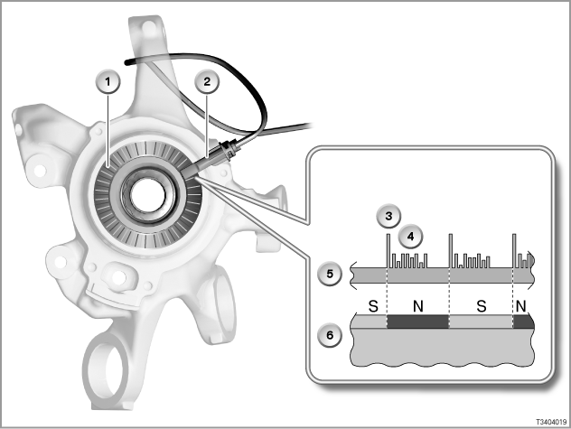

# MK60e5-Standalone

Documenting everything required to run MK60e5 ABS/DSC unit as standalone outside of it's original chassis.

## Introduction

BMW 3-Series vehicles with 6-cylinder engine are equipped as standard with Dynamic Stability Control Mk60E5. This version is an advanced development of DSC Mk60E used on the E87. On the DSC Mk60E in the E87, the brake pressure sensor was integrated in the DSC unit (compared to the DSC Mk60). The DSC Mk60E is also fitted on E90/E91 vehicles with 4-cylinder engine. The supplier for both DSC Mk60E and DSC Mk60E5 is Continental Teves.
DSC Mk60E5 was installed on the following vehicles:

- E87 with 6-cylinder engines from 9/2005
- E85 from 1/2006, E86 from 4/2006
- E90, E91 with 6-cylinder engines from 9/2006, E92 6/2006, E93 12/2006

Note: BMW E9x vehicles with all-wheel drive are equipped as standard with Bosch DSC 8Plus.

## DSC Unit

The DSC unit consists of the hydraulic unit with solenoid valves, DSC control unit and return pump. All 5 brake pressure sensors are integrated into the valve block of the DSC unit. The board of the DSC control unit also holds a longitudinal-acceleration sensor, hence the corect orientation is important.

On LHD vehicles, the DSC unit is located: at the front left in the water box, under a cover panel next to the expansion tank. On RHD vehicles, the DSC unit is located at the front right in the water box (turned through 90°).

The DSC unit part numbers from BMW ETK Online:

|Model and Year|Unit |Notes|
|---|---|---|
|E90 320i LCI 2010 LHD |34516863354 |Same unit on E81, E82, E87, E88 and E9x 4 cylinder gasoline and diesel engines (MK60E) |
|E90 335i LCI 2010 LHD |34516863356 |Same unit on E81, E82, E87, E88 and E9x 6 cylinder gasoline and diesel engines as well as on some N43 and N47 engine cars (MK60E5) |
|E90 M3 LCI 2010 LHD |34507841955 |Unit only on M3 (Old part number: 34507841233) (MK60E5)|
|E85 Z4 2008 LHD |34516778490 |Same on all E85, E86 after 2006 (MK60E5)|

The unit used in this project is the M3 version (photos in [Components/DSC](Components/DSC)): BMW 34 51 7 846 816-01, ATE 10.0212-0801.4. The controller label reads 10.0961-0883.3 / 10.0619-3868.1 / 28.5612-6200.3, "7 846 816 Steuergeraet DSC", made in Hungary. Its firmware is 7846816A (SG type `DSCM90`).

The following page describes additional technical information for [DSC unit](MK60E5-Components/DSCUnit.md)

## Active Wheel Speed sensors (VSS)

Installed on BMW E87 with Inline 6 and E9x and later models. A wheel-speed sensor is installed on each wheel. The magnetic ring used in BMW vehicles has 96 poles around the wheel bearing (increment wheel). The north and south poles of the increment wheel alternate.
One north pole with one south pole constitutes one increment (cf. tooth/gap on an increment gear).
The wheel-speed sensor consists of the actual sensor and an electronic evaluation unit.

|Item|Description|
|---|---|
|1 |Wheel bearing with increment wheel (magnetic ring) |
|2 |Wheel speed sensor |
|3 |Pulse for speed of rotation |
|4 |Additional information, for example direction of rotation and air gap |
|5 |Signal path |
|6 |Wheel bearing with magnets |

Each increment generates 2 pulses in the wheel-speed sensor (96 pulses/revolution of wheel). For the data transmission to the control unit, additional data are added alongside the pulse. Functionally, this integrated data processing goes beyond the simple recording of speed of rotation.

The wheel speed sensor part numbers from BMW ETK Online:

|Model and Year|Front|Rear|Notes|
|---|---|---|---|
|E90 320i LCI 2010 LHD |34526762465 |34526762466 |Same sensor on E81, E82, E87, E88 and E9x 4 cylinder gasoline and diesel engines |
|E90 335i LCI 2010 LHD |34526870075 |34526870077 |Same sensor on E81, E82, E87, E88 and E9x 6 cylinder gasoline and diesel engines as well as on some N43 and N47 engine cars |
|E90 M3 LCI 2010 LHD |34527853586 |34526870077 |Front sensor only on M3, rear sensor same on E81, E82, E87, E88 and E9x 6 cylinder gasoline and diesel engines as well as on some N43 and N47 engine cars |
|E85 Z4  LHD |R:34526792896, L:34526792897 |34526757281 |Front sensor same on all E85, E86 and E46. Rear sensor same on all E85, E86 |

MK60E5 requires active Hall efect VSS with VDA output data stream. Factory sensors on 6 cylinder E8x and E9x are all designed to work with magnetic rings. The following page describes additional technical information on various [wheel speed sensors](MK60E5-Components/WheelSpeedSensors.md).

## DSC Sensor

The DSC sensor measures the rotation of the vehicle around the vertical axis (yaw rate) and the lateral acceleration of the vehicle.

The DSC sensor part numbers from BMW ETK Online:

|Model and Year|Unit |Notes|
|---|---|---|
|E90 320i LCI 2010 LHD |34526850374 |Same DSC sensor on E81, E82, E87, E88 and E9x 4 cylinder gasoline and diesel engines |
|E90 335i LCI 2010 LHD |34516784961 |Same unit on E81, E82, E87, E88 and E9x 6 cylinder gasoline and diesel engines as well as on some N43 and N47 engine cars |
|E90 M3 LCI 2010 LHD |34526850375 |Same unit on E81, E82, E87, E88 and E9x 6 cylinder gasoline and diesel engines |
|E85 Z4 2008 LHD |34526769174 |Same on all E85, E86 after 2006 |

The sensor used in this project (photos in [Components/YAW](Components/YAW)) is BMW 34 52 6 781 575-01 "SENSORCLUSTER 03", ATE 10.1701-0384.3, DV78H04E1E. It sends its data to the DSC over F-CAN.

The following page describes additional technical information for [DSC sensor](MK60E5-Components/DSCSensor.md)

## Steering Angle sensor

The steering angle sensor is part of the steering column switch cluster (SZL). It sends the steering angle to the DSC over F-CAN.

The SZL used in this project (photos in [Components/SZL](Components/SZL)) is BMW LZ 9 123 060-02 (Kostal 10 0016 32-01, HW 27 / SW 68), dated 20.12.2007:

- electronics module 392 00 2082 33-02 (HW 027 / SW 068)
- clock spring BMW 6 989 557-02 (Kostal 04308135-03)
- stalk modules 01 3081 50, 01 1081 60, 01 2081 95

## DSC Button

There is one button, labelled "DSC OFF". BMW calls it the DSC button ("Taster DSC"; SPdaten JBBF70: frame 0x316 "Bedienung Taster DSC", DSC SGBD result `STAT_DSC_TASTER_EIN`). A short press selects DTC (M3 software: M Dynamic Mode); holding it for about 3 s switches DSC off. There is no separate DTC button.

On the E87 and E9x the DSC button is not wired to the DSC. The junction box (JBE) reads the button and sends it to the DSC on PT-CAN in frame 0x316: byte 0 = 0xFC when released and 0xFD while pressed (repeated every 100 ms while held), byte 1 = 0xFF. On the E85/E86 the button is wired to DSC pin 41 instead.

In a standalone installation the button has to be read by your own electronics and sent as frame 0x316. In the BMW pinout for dsc_85/dsc_87, pin 41 is "Not used". An independent disassembly of the M3 firmware, however, finds a hardwired button input, so whether the M3 uses 0x316 or a pin is still open; see [DSC button – open points](MK60E5-Components/DSCButton.md#open-points). See also [MK60E5 CAN interface](MK60E5-CAN/MK60E5_DSC–CAN-Interface.md#pt-can--frames-received-by-dsc).

The following page describes additional technical information for [DSC button](MK60E5-Components/DSCButton.md)

## DSC system functions

DSC uses brake actions and engine intervention to influence longitudinal and lateral dynamics.

Functions familiar from current DSC (MK60):

- ABS: Anti-lock braking system
- EBV: Electronic brake force distribution
- CBC: Cornering Brake Control
- ASC: Automatic stability control
- DTC: Dynamic traction control
- MSR: Engine drag torque control
- DBC: Dynamic brake control
- RPA: Run Flat Indicator (not a driving dynamic control function)
- CBS: Condition Based Service (not a driving dynamic control function)

New functions for DSC Mk60E5:

- Brake Standby through pre-tensioning of the brakes in an emergency
- Brake disc drying on wet roads
- Fading compensation
- Soft stop when braking to standstill (only E87 with 6-cylinder engine, E90, E91, E92, E93)
- Start-off assistant
- Adapted interface for cruise control with brake function (only E90, E91, E92, E93)
- Adapted interface for active cruise control (only E90, E91, E92, E93)
- Yaw-moment compensation via active steering (only E87 with 6-cylinder engine, E90, E91, E92, E93)

## CAN interface

MK60E5 is connected to PT-CAN and F-CAN. The full CAN matrix was extracted from the DSC firmware. It covers every frame DSC sends and receives, the signal layout, cycle times, checksum algorithm and monitoring DTCs. See [MK60E5 CAN interface](MK60E5-CAN/MK60E5_DSC–CAN-Interface.md), which includes generated DBC files.

## References

- BMW TIS
- BMW ETK Online
- Bosch Professional Automotive Information: Brakes, Brake Control and Driver Assistance Systems, Konrad Reif, ISBN978-3-658-03977-6
- [MK60e5 and MK60 ABS retrofit group](https://www.facebook.com/groups/807702710448164)
- [BMW MK60 Motorsports ABS](https://www.facebook.com/groups/1056638784424876)
- [Standalone ABS Installs (MK60 and More)](https://grassrootsmotorsports.com/forum/grm/standalone-abs-installs-mk60-and-more/248099/page1/)
- [cmg5461/mk60e5-firmware](https://github.com/cmg5461/mk60e5-firmware) (MIT): reverse engineering of the MK60E5 firmware, including the E9x M3 firmware 7846816A used in this project. It contains a calibration handbook, an XDF definition, CAN RX/TX tables, coding bytes, an EEPROM map, the minimum PT-CAN frames for standalone use, and a firmware patch for E46 wheel speed sensors.

## Disclaimer

For informational purposes only. Please read the **License** and do your own due dilligence and research.
